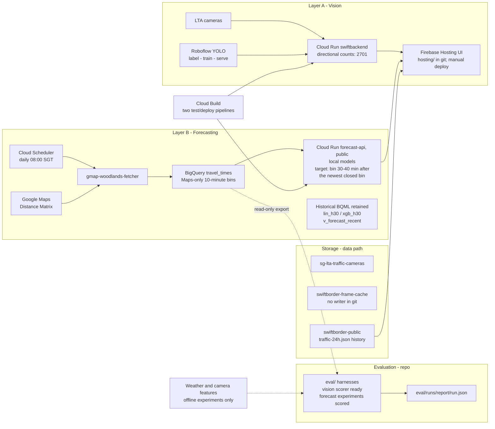
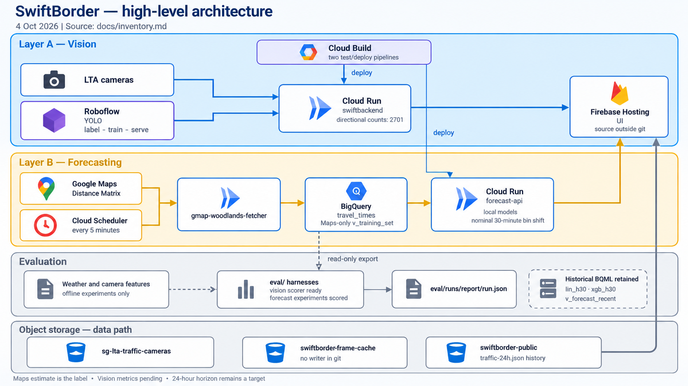
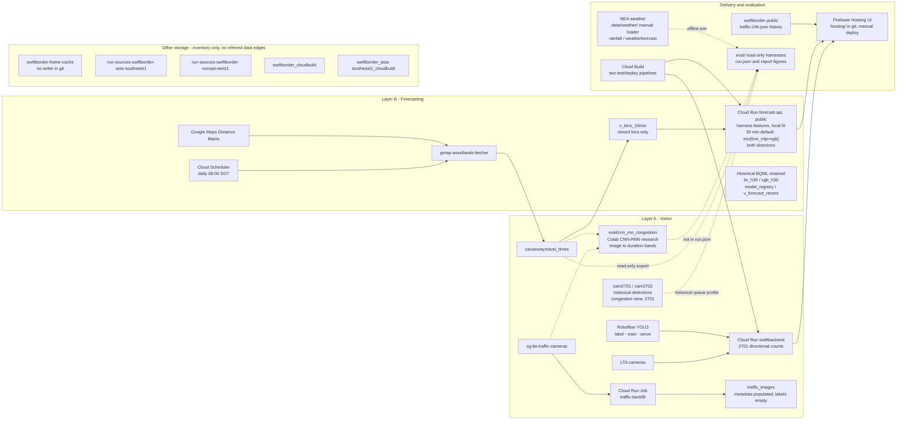
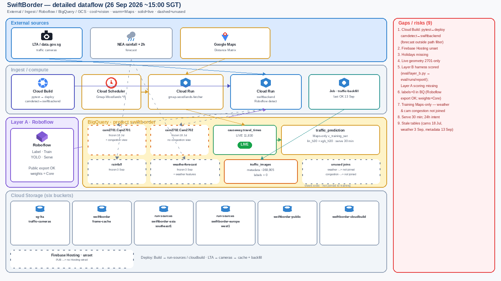

# SwiftBorder GCP architecture

**Project:** `swiftborder` (`1095552466513`)  
**Source of truth:** GCP project `swiftborder`. **Dated resource facts:** [inventory.md](inventory.md). This page describes system design plus in-repo code. Re-query the project before treating counts or serve paths as current.

**Report section:** tools, techniques, and system design. The same system is drawn twice: a **high-level** view, then a **detailed** view. There is no as-is / to-be pair. Performance methods are in [evaluation.md](evaluation.md). Scope that is not in the project yet is in [findings.md](findings.md), not in a second architecture. The resource list is in [inventory.md](inventory.md).

**Diagrams:** Mermaid in [diagrams/](diagrams/) is the **source of truth** for topology and joins. Each view below pairs that Mermaid with a deck PNG under [images/](images/). Edit the `.mmd` file, run `python docs/diagrams/sync_mermaid.py`, then refresh the PNG per [diagrams/README.md](diagrams/README.md).

## Techniques

The module asks the system to demonstrate at least three of these. All four are present. The 30-minute `forecast-api` default in this tree is `mix[fcm_mlp+xgb]` (equal mix of a Fuzzy C-Means MLP and `xgb[maps]`) for both directions. The live revision is the one recorded in [inventory.md](inventory.md).

| Category | In this design |
| --- | --- |
| Supervised learning | Roboflow vehicle labels; BigQuery ML and offline regression of later Maps duration (`y_30`, 60-min offline) |
| Machine learning / deep learning | YOLO served through Roboflow; `lin_h30` (linear regression), `xgb_h30` (boosted tree), offline XGBoost; LSTM, GRU and a patch Transformer are scored offline |
| Intelligent sensing | LTA frame to directional occupancy (`swiftbackend` counts). Dividing lines in `camdetect` cover cameras 2701 and 2702 (2702 added 11 Oct; `cam2701.local_counts` and the 15-frame test report cover 2701). **Also:** Colab CNN-RNN research maps pixels to duration bands (not served) |
| Hybrid / ensemble | The 30-minute default is an equal mix of Fuzzy C-Means + MLP and `xgb[maps]` (`eval/layer_b_fcm_xgb_mix.py`). The older mean of `lin_h30` and `xgb_h30` is scored offline. CNN-RNN **residual** models add a learned correction on top of a time-of-day baseline (notebook only) |

## Roboflow / YOLO free tier

| Claim | Verified |
| --- | --- |
| "YOLO / Roboflow free does not allow label exports" | **Not accurate for dataset labels.** Roboflow Public allows dataset/annotation export after generating a version. |
| What Public *does* gate | **Manual model-weights download** is Core / paid. Credits can also block version generation (usual export path). |

Empty BigQuery `traffic_images.labels` means labelling lives in Roboflow, not that export is impossible on Public.

---

## High-level

Two layers. Layer A turns an LTA frame into directional occupancy through Roboflow. Layer B forecasts Maps `duration_in_traffic` from features of that series. Counts are not crossing time.

**Source:** [diagrams/architecture-high-level.mmd](diagrams/architecture-high-level.mmd)

<!-- mermaid:architecture-high-level -->

<!-- /mermaid:architecture-high-level -->

**Deck export (regenerate from Mermaid when topology changes):**

Regenerated on 4 Oct 2026 after a fresh serving and storage check; see [diagrams/README.md](diagrams/README.md). **Stale since then:** the `forecast-api` input is now `v_bins_10min` (closed bins, harness features), not `v_training_set`, the service is labelled public, and the Hosting node says the source is outside git. The Mermaid above already shows the current labels, including `hosting/` in git with a manual deploy. Regenerate both PNGs before the deck.

The high-level figure shows camera, cache and public-history storage. The detailed figure names all seven verified buckets. Storage inventory nodes have no inferred data-flow edges.

## Detailed

**Source:** [diagrams/architecture-detailed.mmd](diagrams/architecture-detailed.mmd)

<!-- mermaid:architecture-detailed -->

<!-- /mermaid:architecture-detailed -->

Weather and historical camera features are used only in offline experiments. The live `v_training_set` and `forecast-api` inputs are Maps-only. The `eval/` block reads the project without writing to GCP; its dashed inputs denote offline work. `swiftborder-frame-cache` has no writer in git. Deployment and offline-input references are repeated as labelled references in the detailed PNG to avoid crossing connectors.

**Notes**

- `traffic-backfill` is a **Cloud Run Job** (compute), not a BigQuery dataset. Latest execution succeeded 13 Sep 2026, 03:53 SGT, after two failed runs the same day.
- `swiftbackend` is publicly invocable (IAM invoker check disabled, ingress `all`, CORS `*`) and holds `ROBOFLOW_API_KEY` as a plain env var. Recorded as a risk in [findings.md](findings.md); not changed.
- `v_training_set` is built only from `causeway.travel_times`: 10-minute bins, lags, rolling means, time-of-day, weekend and peak flags. Labels are `y_30` and `y_60`.
- `forecast-api` reads closed `v_bins_10min` bins and builds the features with the harness's time-based rules (`local_models.features_from_bins`), then fits and serves local models. The target is the mean over the bin 30-40 minutes after the newest closed bin, which is 9-19 minutes ahead of the request when ingestion is current (`lead_min`). A direction with stale data answers 503. The service is public (invoker IAM check disabled, by decision). `v_forecast_recent`, `lin_h30`, `xgb_h30` and the BQML registry remain as historical resources; the HTTP API does not call them.
- View and BQML DDL checked in under [sql/](../data/sql/) (exported 2026-09-26). Apply order: [sql/README.md](../data/sql/README.md).
- A 24-hour forecast of crossing time is the product intent. The live API's evaluated response is the 30-minute Maps-duration forecast. It can also return exploratory horizons out to 24 h, and `?curve=forecast` draws the study model only to 5.5 h (the generous end of an exploratory study; Holm over 336 comparisons keeps `xgb[maps+prof]` ahead of the profile only to 3 h) and the calendar profile after that. That curve is not a confirmed 24-hour forecast. See [horizon-study.md](horizon-study.md).

What those facts allow the report to claim is in [findings.md](findings.md). Methods and scored results are in [evaluation.md](evaluation.md).

## Offline image-to-duration research (CNN-RNN)

Deepak's Colab notebooks, checked in under [`eval/cnn_rnn_congestion/`](../eval/cnn_rnn_congestion/). This is a **third camera story**, parallel to production Layer A (Chad's detector and [test report](../eval/test-reports/README.md)) and to the scored count experiments in `eval/`.

| Approach | Input | Output | Live? | Scored in `eval/`? |
| --- | --- | --- | --- | --- |
| **Served Layer A** | One frame | Directional vehicle counts (`swiftbackend`) | Yes | Count error on 15 frames; box mAP pending |
| **Layer B + camera features** | Maps bins ± `local_counts` or Mar–Apr profile | Future Maps duration | Forecast API: no camera | Section 7 in [evaluation.md](evaluation.md) |
| **CNN-RNN notebooks** | Frame sequence + time features | Google duration minutes or nine bands; human congestion ratings in v10a | No (Colab) | No |

**Data overlap.** The v10a window (6 Sep – 4 Oct 2026 SGT) uses the same GCS camera tree and `causeway.travel_times` as `cam2701.local_counts` and section 7c. The notebooks do not read `local_counts`; they learn from pixels and Maps labels directly.

**Architectural choice.** Production keeps **interpretable counts** (Layer A) and **Maps-series forecasting** (Layer B) separate because crossing time is not the same as queue depth, and because the serve path must stay small and testable. The CNN-RNN line asks a different question: can a single deep model skip explicit detection and still recover congestion signal? That is useful for the report's "intelligent sensing" and "deep learning" categories, but it is **not** wired into Hosting or `forecast-api` until someone exports a model, defines latency and failure modes, and scores it beside XGBoost the same way `eval/timeseries/deep_forecast.py` does for tabular sequences.

**Label caveat (from the notebook).** Maps duration covers more road than the camera sees, so low Google MAE is not sufficient to claim the image "predicts crossing time." v10a uses blind human ratings and an image-swap ablation for that reason.

**Relation to `eval/timeseries/deep_forecast.py`.** Both use deep learning on the causeway problem, but deep forecast consumes **only** 5-minute Maps bins (LSTM / GRU / Transformer). CNN-RNN consumes **images** and is closer to an alternative Layer A→B bridge than to another tabular forecaster. See [deep-learning-assessment.md](deep-learning-assessment.md) for the scored tabular DL result (do not serve; XGBoost wins on 5 day-blocks).

Runbook: [eval/cnn_rnn_congestion/README.md](../eval/cnn_rnn_congestion/README.md).

**Deck export (regenerated 4 Oct 2026):**

Legacy proposal/target PNGs are not in the repo. Unfinished scope (camera features in the served join, a longer confirmed horizon, `eval/la/layer_a.py` directional crossing-line metrics) is in [findings.md](findings.md) and [roadmap.md](roadmap.md). `hosting/`, `firebase.json`, `.firebaserc`, and `gmapfetcher/` are now in git; the 4 Oct deck PNGs still label `hosting` and `gmap-woodlands-fetcher` from before those commits ([final-report-readiness.md](final-report-readiness.md)).
