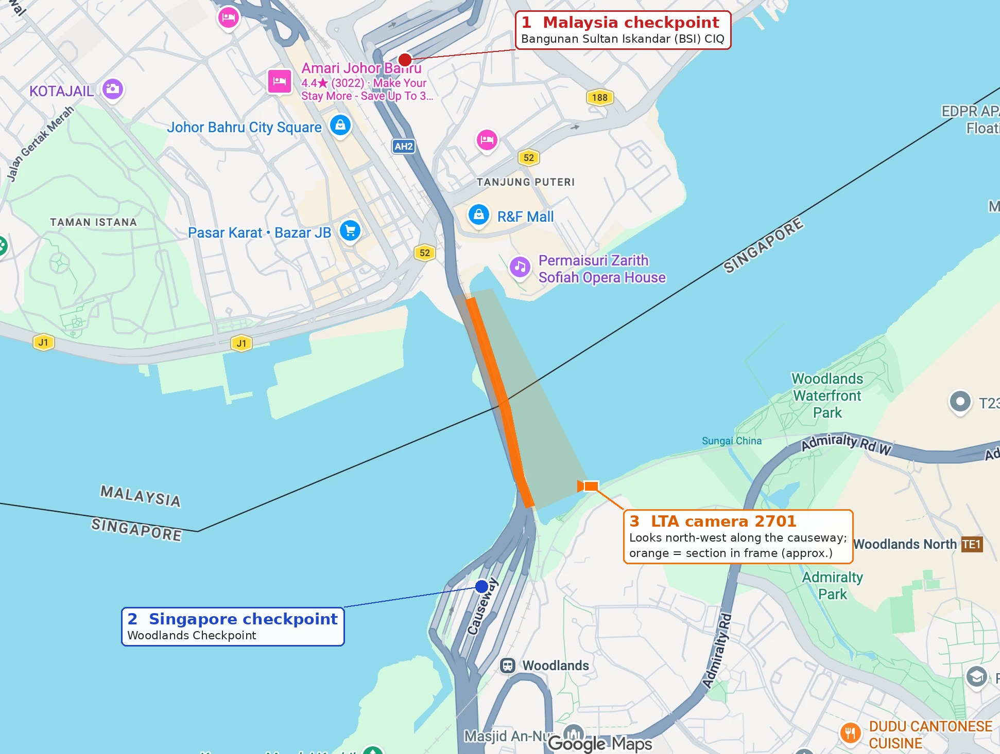

# Camera 2701 coverage and checkpoint distances

Where LTA camera 2701 looks on the Johor–Singapore Causeway, and how far the edges of its view are from the two immigration checkpoints. Drawn and measured on 17 Oct 2026. All figures are map estimates, not surveyed.

| # | Marker | Location | Source |
| --- | --- | --- | --- |
| 1 | Malaysia checkpoint | Bangunan Sultan Iskandar (BSI) CIQ, about 1.4650, 103.7667; about 700 m inland in Johor Bahru, not at the causeway end | OpenStreetMap |
| 2 | Singapore checkpoint | Woodlands Checkpoint, about 1.4460, 103.7686 | OpenStreetMap |
| 3 | LTA camera 2701 | On the Singapore shore east of the causeway, looking north-west along it. Orange is the causeway section in frame (about 840 m, from the Woodlands landing to the Johor shore) | Position placed by the team on the map; see the note below |

## Distance from the edge of the camera view to each checkpoint

| From | To | Straight line | Along the road |
| --- | --- | ---: | ---: |
| Near (south) edge of the view, at the Woodlands landing | Singapore checkpoint (Woodlands) | ~410 m | ~410 m |
| Far (north) edge of the view, at the Johor shore | Malaysia checkpoint (BSI) | ~960 m | ~980 m |

About 1.4 km of road (0.4 km + 1.0 km) lies between the camera view and the two checkpoints, outside the frame.

## How the figures were made

- **Base map.** A Google Maps screenshot, pinned to latitude and longitude with an affine fit on four landmarks with OpenStreetMap coordinates (Johor Bahru City Square, R&F Mall, Permaisuri Zarith Sofiah Opera House, Masjid An-Nur). Fit error is about ±40 px, roughly ±70 m; scale is about 2 m per pixel.
- **Distances.** Haversine distance between map points. "Along the road" follows the drawn road line in short straight segments.
- **View section.** The causeway section in frame is read from camera 2701 frames (the Singapore end at bottom left, rail line and water pipes on the east side, Johor shore at top right). It is not a surveyed field of view.

## Accuracy and caveats

- **About ±50–100 m per distance**, from the map fit and the hand-read view edges.
- **Checkpoint points are each complex's mapped location, not its car booths.** The Woodlands car booths (Block B, about 1.4444, 103.7688) are about 180 m further south than the point used, so the drive from the view edge to the booths is nearer 0.6 km. BSI is a large complex; its car booths may be 100–200 m nearer or farther than the 1 km figure.
- **Camera position.** data.gov.sg's traffic-images API lists camera 2701 at 1.447024, 103.771654 (read 17 Oct 2026), about 200 m south of the position drawn here. The drawn position is the team's placement against the frame; quote the camera position as approximate.

## Why it matters

The camera sees the span **between** the checkpoints, not the checkpoints. A queue inside either checkpoint, or on the roughly 1.4 km of approach outside the frame, adds crossing time that the camera count does not see. This is one reason a count is not a crossing duration ([evaluation.md](../evaluation.md), "One camera sees one stretch").
