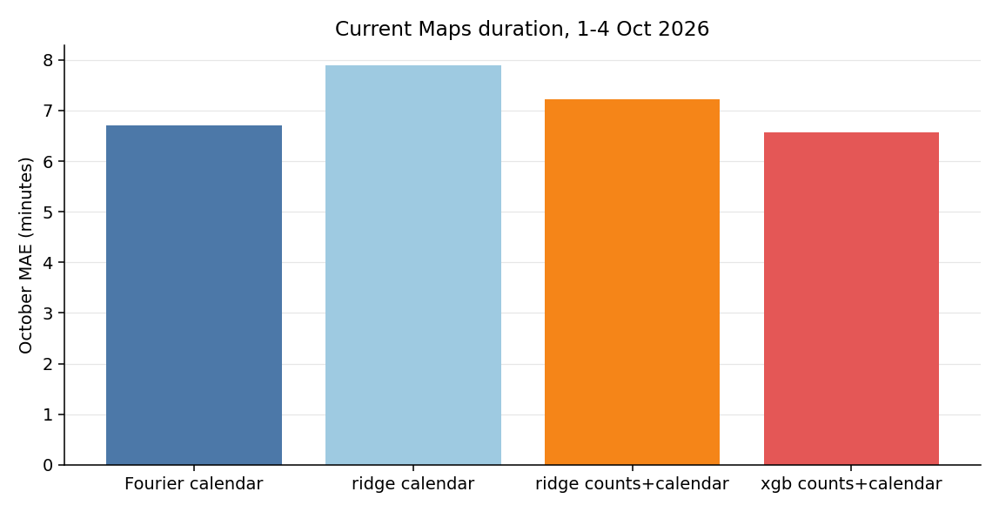
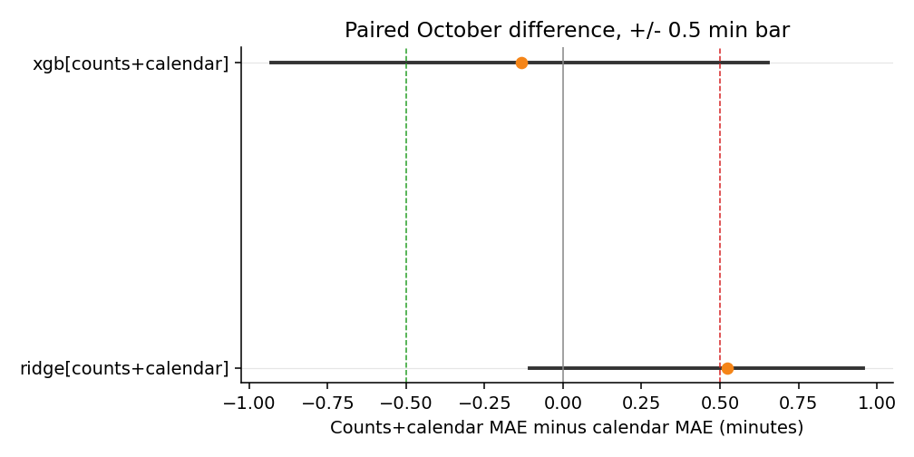
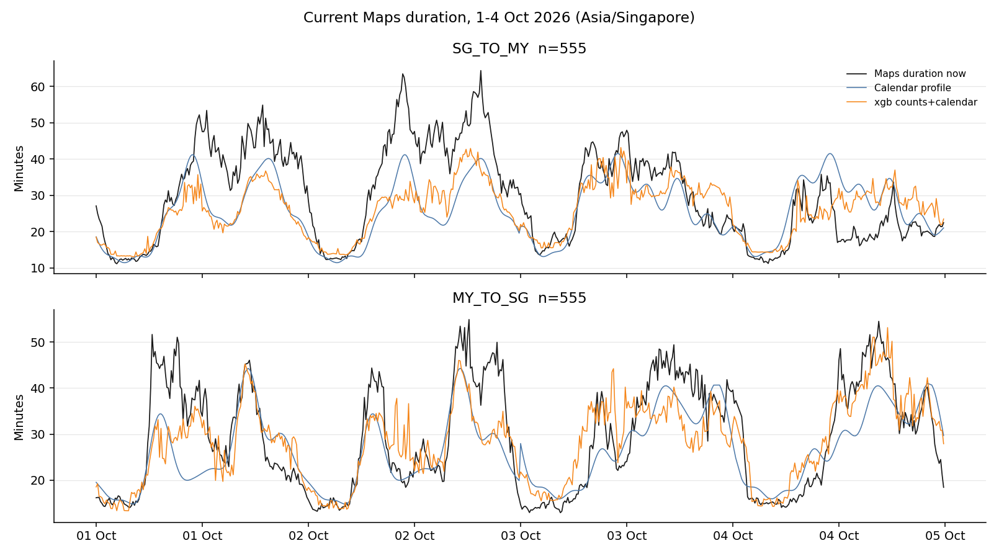

# Camera-only estimate of current travel time

The target is the current 10-minute Maps duration (`y_persistence`), not the 30-minute-ahead label. The calendar baseline is a Fourier profile of that duration, fit on September rows only. Ridge and XGBoost add the current camera-2701 directional count (`sg_my` or `my_sg` in the same bin) to calendar terms (`tod_sin`, `tod_cos`, `dow`, weekend, morning peak, evening peak). They do not read a Maps duration, lag, speed, congestion ratio, or distance at predict time.

## Window

Train: 6972 September rows with a current Maps duration, a camera count, and `after_gap = 0` (6-30 Sep 2026 Asia/Singapore). Eval: 1110 rows on 1-4 Oct (555 SG_TO_MY, 555 MY_TO_SG). Counts end 4 Oct, so later October Maps bins are not in this score.

## Decision

Paired difference is counts-plus-calendar MAE minus the Fourier calendar MAE, in minutes. Negative means the counts model is closer to the current Maps duration. The interval is the joint calendar-day bootstrap (`eval/significance.py`, 4,999 resamples, seed 0, Asia/Singapore). Four days make it coarse. The practical bar is 0.5 min. `improvement` means the interval lies entirely below -0.5; `regression` entirely above +0.5; `no meaningful gain` entirely inside +/-0.5.

| Model | n | MAE counts+calendar | MAE Fourier calendar | MAE ridge calendar | Counts − calendar (95% CI) | Label |
| --- | ---: | ---: | ---: | ---: | --- | --- |
| `ridge[counts+calendar]` | 1110 | 7.225 | 6.702 | 7.891 | 0.522 [-0.106, 0.958] | inconclusive |
| `xgb[counts+calendar]` | 1110 | 6.570 | 6.702 | 7.891 | -0.132 [-0.931, 0.654] | inconclusive |

## Figures

## Visibility

A bin with no scored frame is missing, not zero. A scored frame whose count is zero stays zero. `local_counts` has no column that separates fog, haze, glare, or an empty road, so that flag is not applied.
