# camdetect test reports

Detector test results for camera 2701 (Woodlands Causeway). One test set so far: the 15 frames of the Roboflow dataset v6 **test split**, scored on image-level car and vehicle **counts**, plus box AP50 and car recall/precision from the Colab notebook that produced the comparison. Per-direction count error is not scored: there are no direction labels.

The unit tests for the service itself are in [`services/camdetect/tests/`](../../services/camdetect/tests/) and are described in [the camdetect README](../../services/camdetect/README.md#tests).

| Source | What it holds |
| --- | --- |
| [Detector comparison page](https://claude.ai/artifact/5m7x6QfuGrD911BzgVGyVn) | Interactive version of this report: synced zoom across the annotated frames |
| [`eval/runs/layer_a_count/artifact_counts.json`](../runs/layer_a_count/artifact_counts.json) | Ground truth and the five detectors' counts below, plus each frame's GCS path |
| [`eval/runs/layer_a_count/local_rescore.json`](../runs/layer_a_count/local_rescore.json) | `local:yolo26s-v6-boxfix` rescored on the 1920 x 1080 originals at three settings |
| [`eval/runs/layer_a_count/roboflow_v6_conf02.json`](../runs/layer_a_count/roboflow_v6_conf02.json) | Live `swiftbackend` `model=v6` at its served setting (confidence 0.2), 17 Oct 2026 |
| [`images/`](images/) | The annotated prediction images from the comparison page, one folder per frame |
| [`frames/`](frames/README.md) | The 15 test frames themselves (1920 x 1080 JPEG, unannotated) and a manifest |
| [`speed_benchmark.py`](speed_benchmark.py) | The ONNX speed test (CPU or GPU), from the speed-test notebook |
| [`notebooks/vehicle_detection_comparison.ipynb`](notebooks/vehicle_detection_comparison.ipynb) | Colab notebook with outputs: YOLO26s/m training on dataset v6, the five-detector comparison (box AP50, recall/precision sweep, count error) and the `test_predictions` export. Roboflow key removed; it reads the Colab secret `ROBOFLOW_API_KEY` |
| [`notebooks/onnx_gpu_speed_test.ipynb`](notebooks/onnx_gpu_speed_test.ipynb) | Colab notebook with outputs: the recorded GPU speed run |

Every number on this page is computed from those three JSON files. The narrative and how the result is used in the report are in [docs/evaluation.md](../../docs/evaluation.md#layer-a--vision) and [docs/findings.md](../../docs/findings.md).

## Test set

- **Frames:** 15 camera-2701 frames, 01 Jul 2025 03:15 to 01 Sep 2025 19:06 SGT, in [`frames/`](frames/README.md) as `2701_<YYYYMMDD>T<HHMMSS>.jpg` (1920 x 1080). The same frames are in `gs://sg-lta-traffic-cameras/` (listed in `traffic_images.metadata`). The annotated images in Appendix B are 1280 x 720 copies.
- **Split:** these are the whole `test` split of Roboflow dataset v6 (train 60, valid 15, test 15 images). The detectors were trained on `train`, and the checkpoint epoch was chosen on `valid`, so these frames were not used for gradient updates or checkpoint selection. However, in [`notebooks/vehicle_detection_comparison.ipynb`](notebooks/vehicle_detection_comparison.ipynb) the per-detector confidence threshold reported in the first scoreboard below (`0.30` for YOLO-S / Roboflow v6, `0.25` for YOLO-M, `0.10` for COCO) was chosen by sweeping confidence on these 15 `test` frames (`idxmin` of `count_MAE/img`); the fixed served operating point (`conf=0.20, overlap=0.60`, car MAE **1.87**) is reported in the [Live operating points](#live-operating-points-same-15-originals) section below. The split's label totals (451 cars, 25 buses, 70 trucks; 546 vehicles) equal the sums of the ground-truth column below.
- **Ground truth:** human labels from the Roboflow project. Car totals come from `test_counts.csv`; vehicle totals come from the caption on each ground-truth image. The two agree on car totals for all 15 frames.
- **Day / night:** day is 07:00-18:59 SGT from the file timestamp (7 frames); night is the other 8.
- **Error** is predicted minus ground truth. Positive means over-counting; negative means missed vehicles.

## Detectors

| Detector | Conf | What it is |
| --- | ---: | --- |
| COCO YOLO-S @640 | 0.10 | Stock COCO-pretrained YOLO-S, 640 px input. Baseline, no fine-tuning. |
| COCO YOLO-S @1280 | 0.10 | Same COCO weights at 1280 px input. |
| Roboflow v6 | 0.30 | Roboflow workflow v6 (the `swiftbackend` default). Note: the page scored it at 0.30; the service serves it at 0.2 (see below). |
| YOLO-S trained (freeze) | 0.30 | YOLO26s fine-tuned on Roboflow dataset v6 with `freeze=10` (Colab `v6_yolo26s_boxfix`). Same weights as `models/yolo26s_v6_boxfix.onnx`, served as `model=local`. |
| YOLO-M trained (freeze) | 0.25 | YOLO-M fine-tuned the same way. Weights in [`runs/yolo26m/`](runs/yolo26m/); not served and not rescored. |

## Scoreboard: cars

| Detector | Conf | MAE | Bias | RMSE | MAPE | Net total error | Exact | Within ±2 | Worst miss |
| --- | ---: | ---: | ---: | ---: | ---: | ---: | ---: | ---: | ---: |
| YOLO-S trained (freeze) | 0.30 | 1.73 | +1.33 | 2.42 | 6.6% | +4.4% | 6/15 | 10/15 | 6 |
| YOLO-M trained (freeze) | 0.25 | 1.87 | +1.60 | 3.03 | 14.6% | +5.3% | 6/15 | 10/15 | 9 |
| Roboflow v6 | 0.30 | 3.53 | -1.40 | 5.90 | 25.9% | -4.7% | 2/15 | 10/15 | 19 |
| COCO YOLO-S @1280 | 0.10 | 11.60 | -9.87 | 19.01 | 34.8% | -32.8% | 2/15 | 5/15 | 56 |
| COCO YOLO-S @640 | 0.10 | 17.40 | -13.13 | 26.00 | 50.2% | -43.7% | 1/15 | 5/15 | 70 |

MAPE skips the 15 Jul 01:46 frame (0 cars). Net total error is the sum of predictions against the sum of ground truth over all 15 frames.

## Scoreboard: all vehicles

| Detector | Conf | MAE | Bias | RMSE | MAPE | Net total error | Exact | Within ±2 | Worst miss |
| --- | ---: | ---: | ---: | ---: | ---: | ---: | ---: | ---: | ---: |
| YOLO-S trained (freeze) | 0.30 | 1.47 | +1.33 | 2.25 | 3.5% | +3.7% | 6/15 | 12/15 | 6 |
| YOLO-M trained (freeze) | 0.25 | 2.13 | +1.60 | 3.39 | 14.0% | +4.4% | 4/15 | 10/15 | 10 |
| Roboflow v6 | 0.30 | 4.87 | -4.60 | 7.46 | 10.1% | -12.6% | 5/15 | 8/15 | 19 |
| COCO YOLO-S @1280 | 0.10 | 9.60 | -7.73 | 15.22 | 26.6% | -21.2% | 1/15 | 5/15 | 44 |
| COCO YOLO-S @640 | 0.10 | 19.47 | -15.60 | 27.77 | 46.4% | -42.9% | 1/15 | 4/15 | 71 |

## Day and night (cars)

| Detector | Day MAE (n=7) | Day bias | Night MAE (n=8) | Night bias |
| --- | ---: | ---: | ---: | ---: |
| COCO YOLO-S @640 | 29.29 | -26.14 | 7.00 | -1.75 |
| COCO YOLO-S @1280 | 19.86 | -18.71 | 4.38 | -2.12 |
| Roboflow v6 | 4.86 | -2.86 | 2.38 | -0.12 |
| YOLO-S trained (freeze) | 2.14 | +2.14 | 1.38 | +0.62 |
| YOLO-M trained (freeze) | 2.43 | +2.14 | 1.38 | +1.12 |

The fine-tuned models over-count slightly. Roboflow v6 and both COCO baselines under-count, and their misses are in dense daytime queues: on 19 Jul 09:35 (87 cars) COCO @640 finds 17, Roboflow v6 finds 68 and YOLO-S (freeze) finds 89.

## Per-frame counts

### Cars

Each cell is the prediction with its error in brackets.

| # | Captured (SGT) | GT | COCO YOLO-S @640 | COCO YOLO-S @1280 | Roboflow v6 | YOLO-S trained (freeze) | YOLO-M trained (freeze) |
| ---: | --- | ---: | ---: | ---: | ---: | ---: | ---: |
| [1](#frame-1) | 01 Jul 2025 03:15 | 3 | 5 (+2) | 3 (0) | 4 (+1) | 3 (0) | 3 (0) |
| [2](#frame-2) | 01 Jul 2025 10:46 | 75 | 32 (-43) | 45 (-30) | 73 (-2) | 81 (+6) | 84 (+9) |
| [3](#frame-3) | 01 Jul 2025 17:16 | 33 | 44 (+11) | 37 (+4) | 37 (+4) | 35 (+2) | 36 (+3) |
| [4](#frame-4) | 07 Jul 2025 00:45 | 9 | 10 (+1) | 12 (+3) | 11 (+2) | 11 (+2) | 13 (+4) |
| [5](#frame-5) | 11 Jul 2025 04:55 | 8 | 18 (+10) | 9 (+1) | 9 (+1) | 8 (0) | 8 (0) |
| [6](#frame-6) | 14 Jul 2025 00:15 | 66 | 36 (-30) | 42 (-24) | 57 (-9) | 69 (+3) | 68 (+2) |
| [7](#frame-7) | 14 Jul 2025 10:55 | 56 | 23 (-33) | 37 (-19) | 57 (+1) | 56 (0) | 56 (0) |
| [8](#frame-8) | 15 Jul 2025 01:46 | 0 | 2 (+2) | 0 (0) | 0 (0) | 0 (0) | 0 (0) |
| [9](#frame-9) | 15 Jul 2025 14:45 | 10 | 8 (-2) | 5 (-5) | 10 (0) | 10 (0) | 10 (0) |
| [10](#frame-10) | 18 Jul 2025 18:26 | 39 | 11 (-28) | 21 (-18) | 33 (-6) | 41 (+2) | 39 (0) |
| [11](#frame-11) | 19 Jul 2025 09:35 | 87 | 17 (-70) | 31 (-56) | 68 (-19) | 89 (+2) | 86 (-1) |
| [12](#frame-12) | 20 Jul 2025 02:16 | 1 | 1 (0) | 2 (+1) | 3 (+2) | 1 (0) | 0 (-1) |
| [13](#frame-13) | 22 Jul 2025 07:46 | 24 | 6 (-18) | 17 (-7) | 26 (+2) | 27 (+3) | 28 (+4) |
| [14](#frame-14) | 22 Jul 2025 19:57 | 15 | 10 (-5) | 13 (-2) | 14 (-1) | 12 (-3) | 16 (+1) |
| [15](#frame-15) | 01 Sep 2025 19:06 | 25 | 31 (+6) | 29 (+4) | 28 (+3) | 28 (+3) | 28 (+3) |

### All vehicles

Each cell is the prediction with its error in brackets.

| # | Captured (SGT) | GT | COCO YOLO-S @640 | COCO YOLO-S @1280 | Roboflow v6 | YOLO-S trained (freeze) | YOLO-M trained (freeze) |
| ---: | --- | ---: | ---: | ---: | ---: | ---: | ---: |
| [1](#frame-1) | 01 Jul 2025 03:15 | 5 | 6 (+1) | 5 (0) | 4 (-1) | 5 (0) | 5 (0) |
| [2](#frame-2) | 01 Jul 2025 10:46 | 80 | 39 (-41) | 56 (-24) | 75 (-5) | 86 (+6) | 90 (+10) |
| [3](#frame-3) | 01 Jul 2025 17:16 | 36 | 47 (+11) | 42 (+6) | 38 (+2) | 39 (+3) | 42 (+6) |
| [4](#frame-4) | 07 Jul 2025 00:45 | 14 | 11 (-3) | 16 (+2) | 13 (-1) | 16 (+2) | 17 (+3) |
| [5](#frame-5) | 11 Jul 2025 04:55 | 12 | 19 (+7) | 11 (-1) | 12 (0) | 12 (0) | 12 (0) |
| [6](#frame-6) | 14 Jul 2025 00:15 | 66 | 38 (-28) | 46 (-20) | 58 (-8) | 70 (+4) | 69 (+3) |
| [7](#frame-7) | 14 Jul 2025 10:55 | 72 | 40 (-32) | 66 (-6) | 64 (-8) | 73 (+1) | 72 (0) |
| [8](#frame-8) | 15 Jul 2025 01:46 | 1 | 2 (+1) | 0 (-1) | 1 (0) | 1 (0) | 2 (+1) |
| [9](#frame-9) | 15 Jul 2025 14:45 | 15 | 13 (-2) | 12 (-3) | 15 (0) | 15 (0) | 15 (0) |
| [10](#frame-10) | 18 Jul 2025 18:26 | 45 | 13 (-32) | 26 (-19) | 34 (-11) | 46 (+1) | 43 (-2) |
| [11](#frame-11) | 19 Jul 2025 09:35 | 91 | 20 (-71) | 47 (-44) | 72 (-19) | 93 (+2) | 90 (-1) |
| [12](#frame-12) | 20 Jul 2025 02:16 | 3 | 3 (0) | 4 (+1) | 3 (0) | 3 (0) | 2 (-1) |
| [13](#frame-13) | 22 Jul 2025 07:46 | 51 | 12 (-39) | 42 (-9) | 38 (-13) | 51 (0) | 52 (+1) |
| [14](#frame-14) | 22 Jul 2025 19:57 | 26 | 11 (-15) | 23 (-3) | 21 (-5) | 25 (-1) | 27 (+1) |
| [15](#frame-15) | 01 Sep 2025 19:06 | 29 | 38 (+9) | 34 (+5) | 29 (0) | 31 (+2) | 32 (+3) |

## Served operating points (rescored on the originals)

The page scored each detector at one threshold. The service runs different settings, so the same 15 originals were rescored at what is actually served. `local_counts` in BigQuery (`cam2701.local_counts`) uses the first row's setting, so the 1.73 car MAE above does not describe those rows.

| Setting | Cars MAE | Cars bias | Exact cars | Vehicle MAE | Vehicle bias | Day car MAE (n=7) | Night car MAE (n=8) |
| --- | ---: | ---: | ---: | ---: | ---: | ---: | ---: |
| `model=local`, conf 0.2, overlap 0.6 (served, and `local_counts`) | 1.87 | +1.33 | 5/15 | 1.67 | +1.53 | 2.86 | 1.00 |
| same weights, conf 0.30, overlap off (page's YOLO-S point) | 1.80 | +1.27 | 6/15 | 1.53 | +1.27 | 2.14 | 1.50 |
| same weights, conf 0.30, overlap 0.6 (not served) | 1.13 | -0.33 | 7/15 | 1.27 | -0.73 | 1.00 | 1.25 |
| Roboflow v6, conf 0.2, overlap off (served default) | 4.40 | -2.53 | 2/15 | 6.27 | -6.13 | 6.57 | 2.50 |

YOLO-S (freeze) at the page's setting (conf 0.30, overlap off) matches the page's car count on 14 of 15 frames; on 22 Jul 19:57 the page says 12 and the ONNX rescore says 11. The Roboflow v6 rescore is 15 billed calls to the live service.

### Per-frame cars at the served settings

| # | Captured (SGT) | GT | `local` 0.2 / 0.6 | `local` 0.30 / off | `local` 0.30 / 0.6 | Roboflow v6 0.2 |
| ---: | --- | ---: | ---: | ---: | ---: | ---: |
| 1 | 01 Jul 2025 03:15 | 3 | 3 (0) | 3 (0) | 3 (0) | 4 (+1) |
| 2 | 01 Jul 2025 10:46 | 75 | 82 (+7) | 81 (+6) | 75 (0) | 71 (-4) |
| 3 | 01 Jul 2025 17:16 | 33 | 37 (+4) | 35 (+2) | 34 (+1) | 37 (+4) |
| 4 | 07 Jul 2025 00:45 | 9 | 11 (+2) | 11 (+2) | 11 (+2) | 11 (+2) |
| 5 | 11 Jul 2025 04:55 | 8 | 8 (0) | 8 (0) | 7 (-1) | 9 (+1) |
| 6 | 14 Jul 2025 00:15 | 66 | 64 (-2) | 69 (+3) | 65 (-1) | 56 (-10) |
| 7 | 14 Jul 2025 10:55 | 56 | 56 (0) | 56 (0) | 56 (0) | 57 (+1) |
| 8 | 15 Jul 2025 01:46 | 0 | 0 (0) | 0 (0) | 0 (0) | 0 (0) |
| 9 | 15 Jul 2025 14:45 | 10 | 11 (+1) | 10 (0) | 10 (0) | 9 (-1) |
| 10 | 18 Jul 2025 18:26 | 39 | 40 (+1) | 41 (+2) | 39 (0) | 32 (-7) |
| 11 | 19 Jul 2025 09:35 | 87 | 91 (+4) | 89 (+2) | 82 (-5) | 58 (-29) |
| 12 | 20 Jul 2025 02:16 | 1 | 1 (0) | 1 (0) | 1 (0) | 3 (+2) |
| 13 | 22 Jul 2025 07:46 | 24 | 27 (+3) | 27 (+3) | 25 (+1) | 24 (0) |
| 14 | 22 Jul 2025 19:57 | 15 | 13 (-2) | 11 (-4) | 11 (-4) | 14 (-1) |
| 15 | 01 Sep 2025 19:06 | 25 | 27 (+2) | 28 (+3) | 27 (+2) | 28 (+3) |

## Box metrics (test split)

From the full-comparison cell of [`notebooks/vehicle_detection_comparison.ipynb`](notebooks/vehicle_detection_comparison.ipynb) (run 10 Oct 2026, Tesla T4). A prediction counts as correct when it overlaps a labelled box of the same class at IoU 0.5 or more; labelled polygons are reduced to their enclosing box. AP50 is threshold-free. This is the notebook's own scorer, not [`eval/layer_a.py`](../layer_a.py), and it does not compute mAP50-95; Ultralytics' own evaluation of the two fine-tuned models on this split is under [Model weights and run files](#model-weights-and-run-files). The notebook's car count MAE at each detector's best threshold equals the scoreboard above (17.40, 11.60, 3.53, 1.73, 1.87), which is how these frames are matched to that run.

| Detector | AP50 car | AP50 bus | AP50 truck | mAP50 (3 classes) | AP50 any vehicle | Time per image |
| --- | ---: | ---: | ---: | ---: | ---: | ---: |
| COCO YOLO-S @640 | 0.486 | 0.408 | 0.253 | 0.383 | 0.520 | 6.2 ms (T4 GPU) |
| COCO YOLO-S @1280 | 0.714 | 0.576 | 0.362 | 0.551 | 0.733 | 23.6 ms (T4 GPU) |
| Roboflow v6 | 0.757 | 0.444 | 0.595 | 0.599 | 0.744 | 182 ms (API round trip) |
| YOLO-S trained (freeze) | 0.899 | 0.798 | 0.784 | 0.827 | 0.895 | 23.2 ms (T4 GPU) |
| YOLO-M trained (freeze) | 0.894 | 0.912 | 0.781 | 0.862 | 0.890 | 57.2 ms (T4 GPU) |

Car recall and precision at the threshold each detector uses on the scoreboard (the one with the lowest car count MAE in a 0.10-0.50 sweep):

| Detector | Conf | Car recall | Car precision | Car count ratio (predicted / labelled) |
| --- | ---: | ---: | ---: | ---: |
| COCO YOLO-S @640 | 0.10 | 0.368 | 0.654 | 0.563 |
| COCO YOLO-S @1280 | 0.10 | 0.548 | 0.815 | 0.672 |
| Roboflow v6 | 0.30 | 0.696 | 0.730 | 0.953 |
| YOLO-S trained (freeze) | 0.30 | 0.867 | 0.830 | 1.044 |
| YOLO-M trained (freeze) | 0.25 | 0.863 | 0.819 | 1.053 |

The `Time per image` column is Ultralytics predict on a T4 at each model's input size; it is not the served latency. The YOLO26s checkpoint's own training log reports mAP50 0.833 / mAP50-95 0.558 on the `valid` split, which is also the split that chose it.

## Speed test

[`speed_benchmark.py`](speed_benchmark.py) times the served ONNX file (`models/yolo26s_v6_boxfix.onnx`, 736 x 1280 input) with onnxruntime. Frames are read before timing, so only preprocessing (decode, letterbox) and inference are measured; NMS and the HTTP handler are not.

| Run | Hardware | onnxruntime | Frames | Preprocess avg | Inference avg (median) | Total avg | Images/s |
| --- | --- | --- | --- | ---: | ---: | ---: | ---: |
| Colab, [`onnx_gpu_speed_test.ipynb`](notebooks/onnx_gpu_speed_test.ipynb) | Colab GPU, `CUDAExecutionProvider` (card not logged) | 1.31.0 | 20 live frames, cameras 2701 and 2702 | 14.7 ms | 4.4 ms (4.4) | 19.2 ms | 52.1 |
| This repo, 17 Oct 2026 | 4 vCPU Intel Xeon 2.10 GHz, `CPUExecutionProvider` | 1.29.0 | the 15 [`frames/`](frames/README.md) | 55.1 ms | 154.2 ms (159.6) | 209.3 ms | 4.8 |

The Colab run downloaded the 20 most recent frames (every 10 minutes going back from an hour before the run) and did not save them, so that exact set cannot be recovered. To repeat the test on fixed images, run it on the committed test frames:

```bash
# from repo root
python eval/test-reports/speed_benchmark.py --model services/camdetect/models/yolo26s_v6_boxfix.onnx --frames eval/test-reports/frames --n 15
```

The `swiftbackend` Cloud Run service is CPU-only. The earlier local measurement of the full `model=local` handler is about 0.5 s per frame ([CHANGELOG](../../CHANGELOG.md)).

## Model weights and run files

The training runs, both checkpoints, the Ultralytics test-split evaluations and the full-size comparison outputs are in [`runs/`](runs/README.md), regrouped from the team Drive folder `swiftborder_runs`.

| Detector | Weights | Notes |
| --- | --- | --- |
| YOLO-S trained (freeze) | [`runs/yolo26s/training/weights/best.pt`](runs/yolo26s/training/weights/best.pt), and the served ONNX export [`services/camdetect/models/yolo26s_v6_boxfix.onnx`](../../services/camdetect/models/yolo26s_v6_boxfix.onnx) | Ultralytics on the test split: mAP50 0.836, mAP50-95 0.562 |
| YOLO-M trained (freeze) | [`runs/yolo26m/training/weights/best.pt`](runs/yolo26m/training/weights/best.pt) | Not exported, not served. Test split: mAP50 0.872, mAP50-95 0.583 |
| COCO YOLO-S @640 / @1280 | stock `yolo26s.pt`, downloaded by Ultralytics | No fine-tuning |
| Roboflow v6 | Hosted by Roboflow; weight download needs a Core plan | Raw API replies in [`runs/comparison_5_detectors/roboflow_v6/api_responses/`](runs/comparison_5_detectors/roboflow_v6/api_responses/) |

## What this does not show

- **Box metrics are the notebooks'.** AP50, recall and precision come from the Colab scorer above, and mAP50-95 only from Ultralytics for the two fine-tuned models. [`eval/layer_a.py`](../layer_a.py) has not been run on this split, and the box labels are in Roboflow, not in git.
- **No direction score.** There are no direction labels, so per-direction count error is not measured.
- **Small sample.** 15 frames from July and September 2025, one camera. One frame (19 Jul 09:35) dominates the baselines' error.
- **Counts are not crossing time.** A good count is an input to Layer B, not a forecast result.

## Appendix A: vehicle counts, every frame and detector

Total vehicles only. One row per frame; each detector setting has three sub-columns: ground truth, the detector's count, and its error (predicted minus ground truth). The first five settings are the comparison page's detectors; the last four are rescores of the 1920 x 1080 originals at served settings. Conf and overlap are in the header; the page did not record its overlap setting.

<table>
<thead>
<tr><th rowspan="2">#</th><th rowspan="2">Captured (SGT)</th><th colspan="3">COCO YOLO-S @640<br>conf 0.10</th><th colspan="3">COCO YOLO-S @1280<br>conf 0.10</th><th colspan="3">Roboflow v6<br>conf 0.30</th><th colspan="3">YOLO-S trained (freeze)<br>conf 0.30</th><th colspan="3">YOLO-M trained (freeze)<br>conf 0.25</th><th colspan="3"><code>model=local</code> (served)<br>conf 0.20, overlap 0.6</th><th colspan="3"><code>local</code><br>conf 0.30, overlap off</th><th colspan="3"><code>local</code> (not served)<br>conf 0.30, overlap 0.6</th><th colspan="3">Roboflow v6 (served)<br>conf 0.20, overlap off</th></tr>
<tr><th>GT</th><th>Count</th><th>Error</th><th>GT</th><th>Count</th><th>Error</th><th>GT</th><th>Count</th><th>Error</th><th>GT</th><th>Count</th><th>Error</th><th>GT</th><th>Count</th><th>Error</th><th>GT</th><th>Count</th><th>Error</th><th>GT</th><th>Count</th><th>Error</th><th>GT</th><th>Count</th><th>Error</th><th>GT</th><th>Count</th><th>Error</th></tr>
</thead>
<tbody>
<tr><td><a href="#frame-1">1</a></td><td>01 Jul 2025 03:15</td><td align="right">5</td><td align="right">6</td><td align="right">+1</td><td align="right">5</td><td align="right">5</td><td align="right">0</td><td align="right">5</td><td align="right">4</td><td align="right">-1</td><td align="right">5</td><td align="right">5</td><td align="right">0</td><td align="right">5</td><td align="right">5</td><td align="right">0</td><td align="right">5</td><td align="right">5</td><td align="right">0</td><td align="right">5</td><td align="right">5</td><td align="right">0</td><td align="right">5</td><td align="right">5</td><td align="right">0</td><td align="right">5</td><td align="right">4</td><td align="right">-1</td></tr>
<tr><td><a href="#frame-2">2</a></td><td>01 Jul 2025 10:46</td><td align="right">80</td><td align="right">39</td><td align="right">-41</td><td align="right">80</td><td align="right">56</td><td align="right">-24</td><td align="right">80</td><td align="right">75</td><td align="right">-5</td><td align="right">80</td><td align="right">86</td><td align="right">+6</td><td align="right">80</td><td align="right">90</td><td align="right">+10</td><td align="right">80</td><td align="right">87</td><td align="right">+7</td><td align="right">80</td><td align="right">86</td><td align="right">+6</td><td align="right">80</td><td align="right">80</td><td align="right">0</td><td align="right">80</td><td align="right">73</td><td align="right">-7</td></tr>
<tr><td><a href="#frame-3">3</a></td><td>01 Jul 2025 17:16</td><td align="right">36</td><td align="right">47</td><td align="right">+11</td><td align="right">36</td><td align="right">42</td><td align="right">+6</td><td align="right">36</td><td align="right">38</td><td align="right">+2</td><td align="right">36</td><td align="right">39</td><td align="right">+3</td><td align="right">36</td><td align="right">42</td><td align="right">+6</td><td align="right">36</td><td align="right">42</td><td align="right">+6</td><td align="right">36</td><td align="right">39</td><td align="right">+3</td><td align="right">36</td><td align="right">38</td><td align="right">+2</td><td align="right">36</td><td align="right">37</td><td align="right">+1</td></tr>
<tr><td><a href="#frame-4">4</a></td><td>07 Jul 2025 00:45</td><td align="right">14</td><td align="right">11</td><td align="right">-3</td><td align="right">14</td><td align="right">16</td><td align="right">+2</td><td align="right">14</td><td align="right">13</td><td align="right">-1</td><td align="right">14</td><td align="right">16</td><td align="right">+2</td><td align="right">14</td><td align="right">17</td><td align="right">+3</td><td align="right">14</td><td align="right">15</td><td align="right">+1</td><td align="right">14</td><td align="right">16</td><td align="right">+2</td><td align="right">14</td><td align="right">15</td><td align="right">+1</td><td align="right">14</td><td align="right">13</td><td align="right">-1</td></tr>
<tr><td><a href="#frame-5">5</a></td><td>11 Jul 2025 04:55</td><td align="right">12</td><td align="right">19</td><td align="right">+7</td><td align="right">12</td><td align="right">11</td><td align="right">-1</td><td align="right">12</td><td align="right">12</td><td align="right">0</td><td align="right">12</td><td align="right">12</td><td align="right">0</td><td align="right">12</td><td align="right">12</td><td align="right">0</td><td align="right">12</td><td align="right">12</td><td align="right">0</td><td align="right">12</td><td align="right">12</td><td align="right">0</td><td align="right">12</td><td align="right">11</td><td align="right">-1</td><td align="right">12</td><td align="right">10</td><td align="right">-2</td></tr>
<tr><td><a href="#frame-6">6</a></td><td>14 Jul 2025 00:15</td><td align="right">66</td><td align="right">38</td><td align="right">-28</td><td align="right">66</td><td align="right">46</td><td align="right">-20</td><td align="right">66</td><td align="right">58</td><td align="right">-8</td><td align="right">66</td><td align="right">70</td><td align="right">+4</td><td align="right">66</td><td align="right">69</td><td align="right">+3</td><td align="right">66</td><td align="right">65</td><td align="right">-1</td><td align="right">66</td><td align="right">70</td><td align="right">+4</td><td align="right">66</td><td align="right">66</td><td align="right">0</td><td align="right">66</td><td align="right">56</td><td align="right">-10</td></tr>
<tr><td><a href="#frame-7">7</a></td><td>14 Jul 2025 10:55</td><td align="right">72</td><td align="right">40</td><td align="right">-32</td><td align="right">72</td><td align="right">66</td><td align="right">-6</td><td align="right">72</td><td align="right">64</td><td align="right">-8</td><td align="right">72</td><td align="right">73</td><td align="right">+1</td><td align="right">72</td><td align="right">72</td><td align="right">0</td><td align="right">72</td><td align="right">72</td><td align="right">0</td><td align="right">72</td><td align="right">73</td><td align="right">+1</td><td align="right">72</td><td align="right">71</td><td align="right">-1</td><td align="right">72</td><td align="right">64</td><td align="right">-8</td></tr>
<tr><td><a href="#frame-8">8</a></td><td>15 Jul 2025 01:46</td><td align="right">1</td><td align="right">2</td><td align="right">+1</td><td align="right">1</td><td align="right">0</td><td align="right">-1</td><td align="right">1</td><td align="right">1</td><td align="right">0</td><td align="right">1</td><td align="right">1</td><td align="right">0</td><td align="right">1</td><td align="right">2</td><td align="right">+1</td><td align="right">1</td><td align="right">1</td><td align="right">0</td><td align="right">1</td><td align="right">1</td><td align="right">0</td><td align="right">1</td><td align="right">1</td><td align="right">0</td><td align="right">1</td><td align="right">1</td><td align="right">0</td></tr>
<tr><td><a href="#frame-9">9</a></td><td>15 Jul 2025 14:45</td><td align="right">15</td><td align="right">13</td><td align="right">-2</td><td align="right">15</td><td align="right">12</td><td align="right">-3</td><td align="right">15</td><td align="right">15</td><td align="right">0</td><td align="right">15</td><td align="right">15</td><td align="right">0</td><td align="right">15</td><td align="right">15</td><td align="right">0</td><td align="right">15</td><td align="right">16</td><td align="right">+1</td><td align="right">15</td><td align="right">15</td><td align="right">0</td><td align="right">15</td><td align="right">15</td><td align="right">0</td><td align="right">15</td><td align="right">14</td><td align="right">-1</td></tr>
<tr><td><a href="#frame-10">10</a></td><td>18 Jul 2025 18:26</td><td align="right">45</td><td align="right">13</td><td align="right">-32</td><td align="right">45</td><td align="right">26</td><td align="right">-19</td><td align="right">45</td><td align="right">34</td><td align="right">-11</td><td align="right">45</td><td align="right">46</td><td align="right">+1</td><td align="right">45</td><td align="right">43</td><td align="right">-2</td><td align="right">45</td><td align="right">45</td><td align="right">0</td><td align="right">45</td><td align="right">46</td><td align="right">+1</td><td align="right">45</td><td align="right">43</td><td align="right">-2</td><td align="right">45</td><td align="right">33</td><td align="right">-12</td></tr>
<tr><td><a href="#frame-11">11</a></td><td>19 Jul 2025 09:35</td><td align="right">91</td><td align="right">20</td><td align="right">-71</td><td align="right">91</td><td align="right">47</td><td align="right">-44</td><td align="right">91</td><td align="right">72</td><td align="right">-19</td><td align="right">91</td><td align="right">93</td><td align="right">+2</td><td align="right">91</td><td align="right">90</td><td align="right">-1</td><td align="right">91</td><td align="right">95</td><td align="right">+4</td><td align="right">91</td><td align="right">93</td><td align="right">+2</td><td align="right">91</td><td align="right">86</td><td align="right">-5</td><td align="right">91</td><td align="right">61</td><td align="right">-30</td></tr>
<tr><td><a href="#frame-12">12</a></td><td>20 Jul 2025 02:16</td><td align="right">3</td><td align="right">3</td><td align="right">0</td><td align="right">3</td><td align="right">4</td><td align="right">+1</td><td align="right">3</td><td align="right">3</td><td align="right">0</td><td align="right">3</td><td align="right">3</td><td align="right">0</td><td align="right">3</td><td align="right">2</td><td align="right">-1</td><td align="right">3</td><td align="right">3</td><td align="right">0</td><td align="right">3</td><td align="right">3</td><td align="right">0</td><td align="right">3</td><td align="right">3</td><td align="right">0</td><td align="right">3</td><td align="right">3</td><td align="right">0</td></tr>
<tr><td><a href="#frame-13">13</a></td><td>22 Jul 2025 07:46</td><td align="right">51</td><td align="right">12</td><td align="right">-39</td><td align="right">51</td><td align="right">42</td><td align="right">-9</td><td align="right">51</td><td align="right">38</td><td align="right">-13</td><td align="right">51</td><td align="right">51</td><td align="right">0</td><td align="right">51</td><td align="right">52</td><td align="right">+1</td><td align="right">51</td><td align="right">51</td><td align="right">0</td><td align="right">51</td><td align="right">51</td><td align="right">0</td><td align="right">51</td><td align="right">47</td><td align="right">-4</td><td align="right">51</td><td align="right">35</td><td align="right">-16</td></tr>
<tr><td><a href="#frame-14">14</a></td><td>22 Jul 2025 19:57</td><td align="right">26</td><td align="right">11</td><td align="right">-15</td><td align="right">26</td><td align="right">23</td><td align="right">-3</td><td align="right">26</td><td align="right">21</td><td align="right">-5</td><td align="right">26</td><td align="right">25</td><td align="right">-1</td><td align="right">26</td><td align="right">27</td><td align="right">+1</td><td align="right">26</td><td align="right">29</td><td align="right">+3</td><td align="right">26</td><td align="right">24</td><td align="right">-2</td><td align="right">26</td><td align="right">24</td><td align="right">-2</td><td align="right">26</td><td align="right">21</td><td align="right">-5</td></tr>
<tr><td><a href="#frame-15">15</a></td><td>01 Sep 2025 19:06</td><td align="right">29</td><td align="right">38</td><td align="right">+9</td><td align="right">29</td><td align="right">34</td><td align="right">+5</td><td align="right">29</td><td align="right">29</td><td align="right">0</td><td align="right">29</td><td align="right">31</td><td align="right">+2</td><td align="right">29</td><td align="right">32</td><td align="right">+3</td><td align="right">29</td><td align="right">31</td><td align="right">+2</td><td align="right">29</td><td align="right">31</td><td align="right">+2</td><td align="right">29</td><td align="right">30</td><td align="right">+1</td><td align="right">29</td><td align="right">29</td><td align="right">0</td></tr>
</tbody>
<tfoot>
<tr><th colspan="2">Vehicle MAE</th><th colspan="3">19.47</th><th colspan="3">9.60</th><th colspan="3">4.87</th><th colspan="3">1.47</th><th colspan="3">2.13</th><th colspan="3">1.67</th><th colspan="3">1.53</th><th colspan="3">1.27</th><th colspan="3">6.27</th></tr>
</tfoot>
</table>

## Appendix B: annotated frames

Each frame shows the ground-truth labels and the five detectors' boxes, as exported in `test_predictions` (1280 x 720 copies). The caption strip on each image gives its count.

<a id="frame-1"></a>

### Frame 1: 01 Jul 2025 03:15 SGT

Ground truth 3 cars, 5 vehicles. Source `gs://sg-lta-traffic-cameras/camera_id=2701/month=2025-07/2701_20250701T031541.jpg`.

<table><tr>
<td><a href="images/20250701T031541/ground_truth.webp">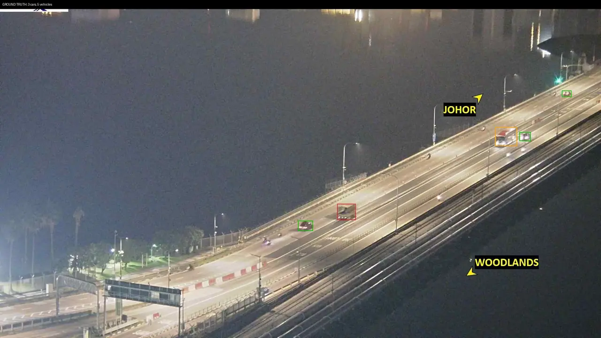</a><br>Ground truth</td>
<td><a href="images/20250701T031541/coco_s_640.webp"></a><br>COCO YOLO-S @640: 5 cars (+2)</td>
<td><a href="images/20250701T031541/coco_s_1280.webp"></a><br>COCO YOLO-S @1280: 3 cars (0)</td>
</tr><tr>
<td><a href="images/20250701T031541/roboflow_v6.webp"></a><br>Roboflow v6: 4 cars (+1)</td>
<td><a href="images/20250701T031541/trained_s.webp"></a><br>YOLO-S trained (freeze): 3 cars (0)</td>
<td><a href="images/20250701T031541/trained_m.webp"></a><br>YOLO-M trained (freeze): 3 cars (0)</td>
</tr></table>

<a id="frame-2"></a>

### Frame 2: 01 Jul 2025 10:46 SGT

Ground truth 75 cars, 80 vehicles. Source `gs://sg-lta-traffic-cameras/camera_id=2701/month=2025-07/2701_20250701T104609.jpg`.

<table><tr>
<td><a href="images/20250701T104609/ground_truth.webp">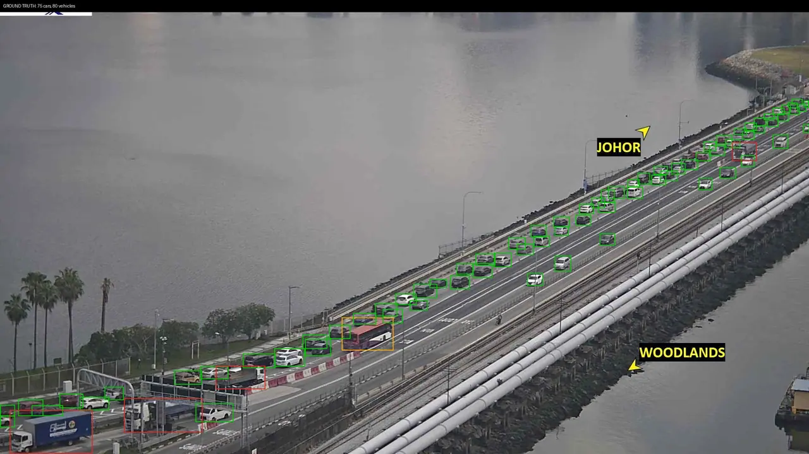</a><br>Ground truth</td>
<td><a href="images/20250701T104609/coco_s_640.webp">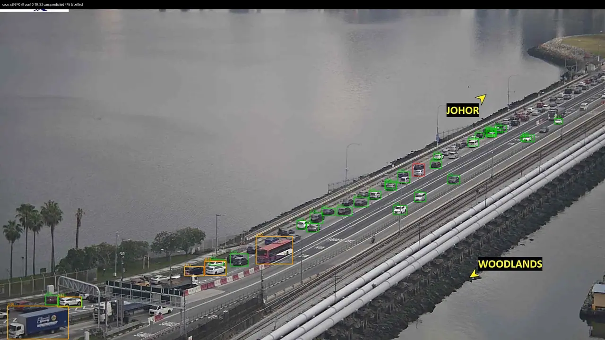</a><br>COCO YOLO-S @640: 32 cars (-43)</td>
<td><a href="images/20250701T104609/coco_s_1280.webp">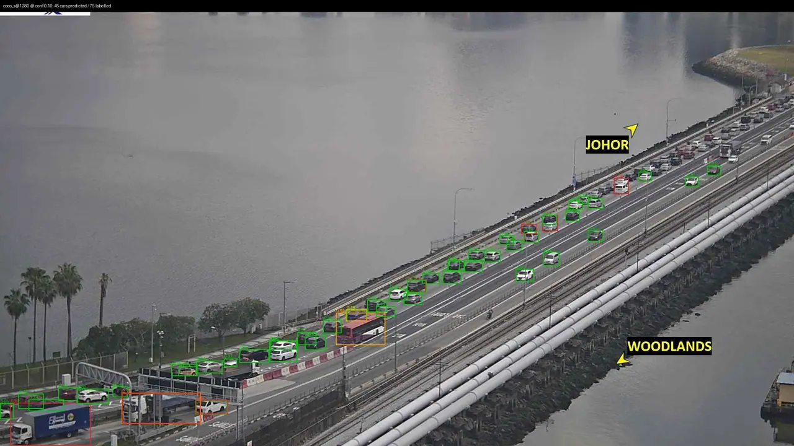</a><br>COCO YOLO-S @1280: 45 cars (-30)</td>
</tr><tr>
<td><a href="images/20250701T104609/roboflow_v6.webp"></a><br>Roboflow v6: 73 cars (-2)</td>
<td><a href="images/20250701T104609/trained_s.webp">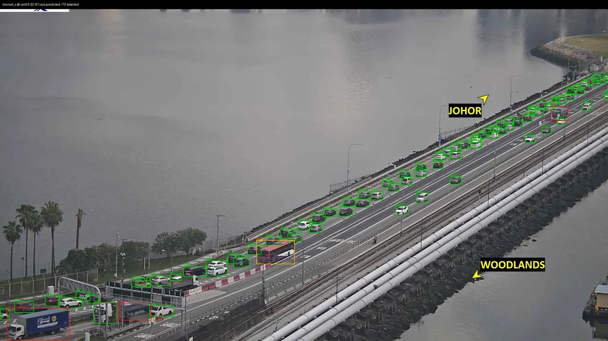</a><br>YOLO-S trained (freeze): 81 cars (+6)</td>
<td><a href="images/20250701T104609/trained_m.webp">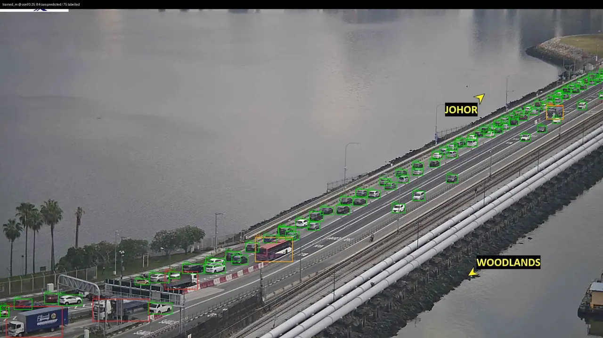</a><br>YOLO-M trained (freeze): 84 cars (+9)</td>
</tr></table>

<a id="frame-3"></a>

### Frame 3: 01 Jul 2025 17:16 SGT

Ground truth 33 cars, 36 vehicles. Source `gs://sg-lta-traffic-cameras/camera_id=2701/month=2025-07/2701_20250701T171615.jpg`.

<table><tr>
<td><a href="images/20250701T171615/ground_truth.webp"></a><br>Ground truth</td>
<td><a href="images/20250701T171615/coco_s_640.webp">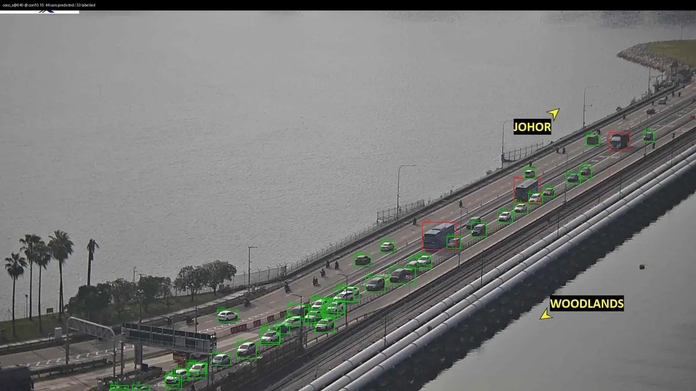</a><br>COCO YOLO-S @640: 44 cars (+11)</td>
<td><a href="images/20250701T171615/coco_s_1280.webp">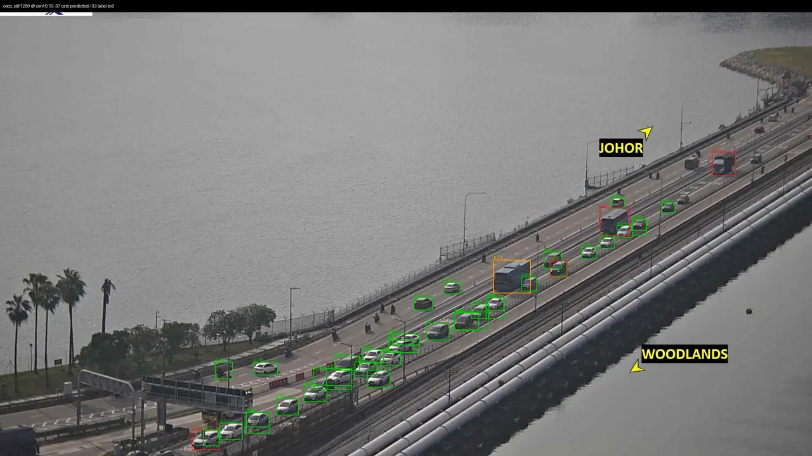</a><br>COCO YOLO-S @1280: 37 cars (+4)</td>
</tr><tr>
<td><a href="images/20250701T171615/roboflow_v6.webp">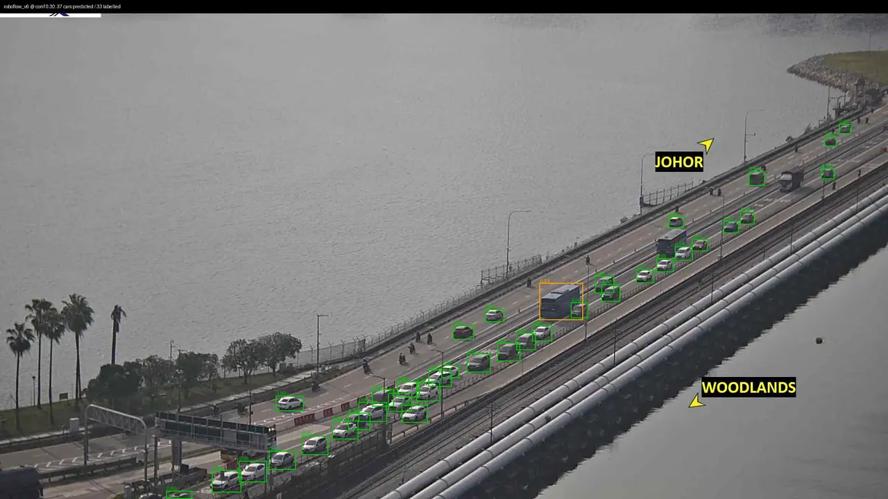</a><br>Roboflow v6: 37 cars (+4)</td>
<td><a href="images/20250701T171615/trained_s.webp">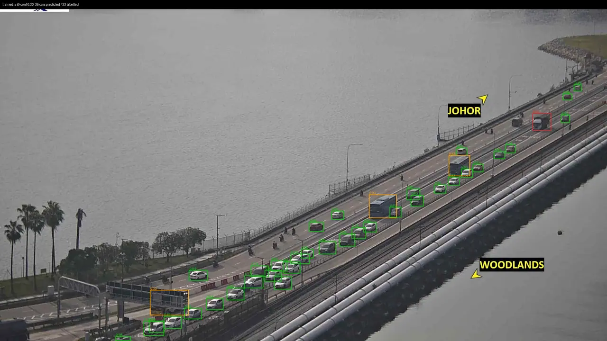</a><br>YOLO-S trained (freeze): 35 cars (+2)</td>
<td><a href="images/20250701T171615/trained_m.webp"></a><br>YOLO-M trained (freeze): 36 cars (+3)</td>
</tr></table>

<a id="frame-4"></a>

### Frame 4: 07 Jul 2025 00:45 SGT

Ground truth 9 cars, 14 vehicles. Source `gs://sg-lta-traffic-cameras/camera_id=2701/month=2025-07/2701_20250707T004549.jpg`.

<table><tr>
<td><a href="images/20250707T004549/ground_truth.webp"></a><br>Ground truth</td>
<td><a href="images/20250707T004549/coco_s_640.webp">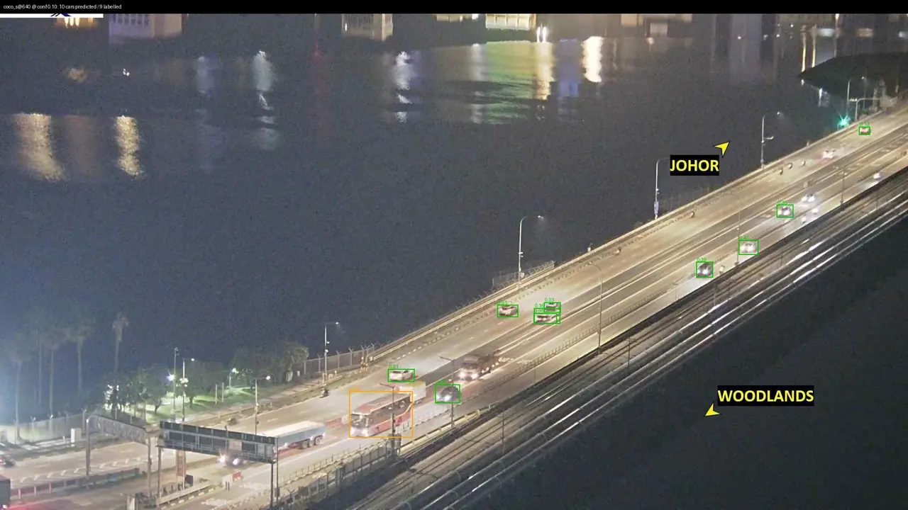</a><br>COCO YOLO-S @640: 10 cars (+1)</td>
<td><a href="images/20250707T004549/coco_s_1280.webp">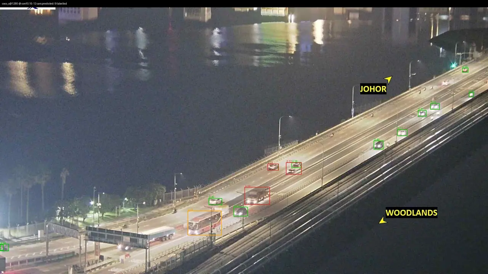</a><br>COCO YOLO-S @1280: 12 cars (+3)</td>
</tr><tr>
<td><a href="images/20250707T004549/roboflow_v6.webp">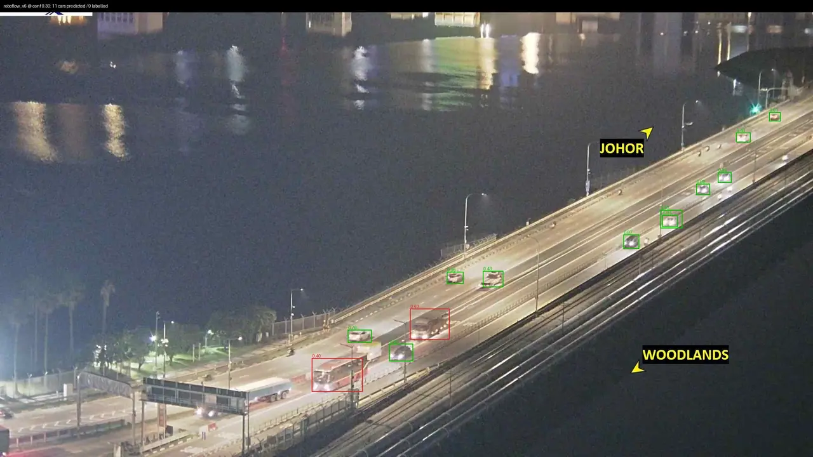</a><br>Roboflow v6: 11 cars (+2)</td>
<td><a href="images/20250707T004549/trained_s.webp">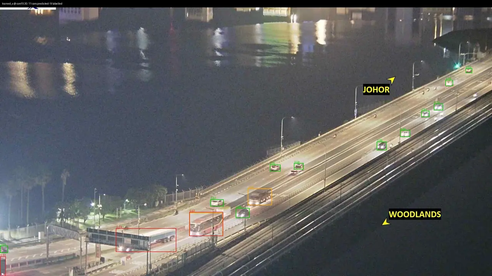</a><br>YOLO-S trained (freeze): 11 cars (+2)</td>
<td><a href="images/20250707T004549/trained_m.webp">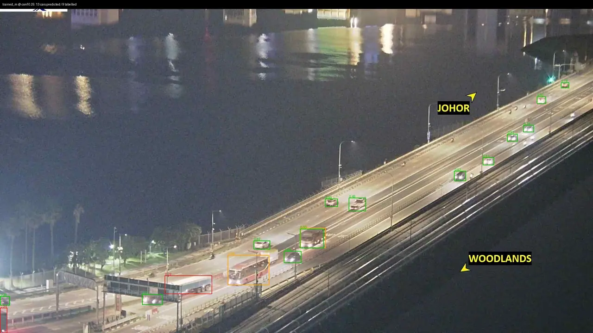</a><br>YOLO-M trained (freeze): 13 cars (+4)</td>
</tr></table>

<a id="frame-5"></a>

### Frame 5: 11 Jul 2025 04:55 SGT

Ground truth 8 cars, 12 vehicles. Source `gs://sg-lta-traffic-cameras/camera_id=2701/month=2025-07/2701_20250711T045532.jpg`.

<table><tr>
<td><a href="images/20250711T045532/ground_truth.webp"></a><br>Ground truth</td>
<td><a href="images/20250711T045532/coco_s_640.webp">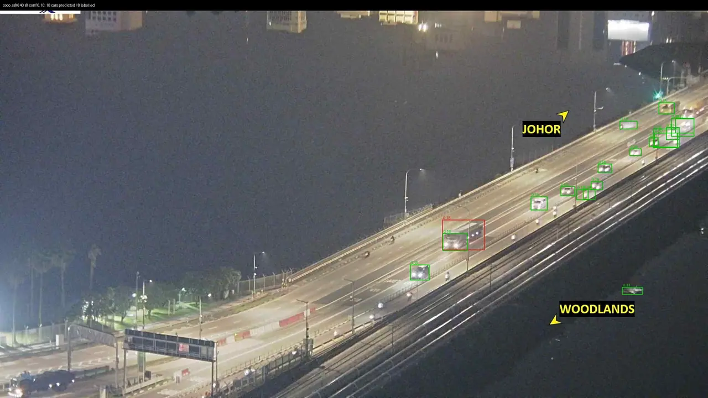</a><br>COCO YOLO-S @640: 18 cars (+10)</td>
<td><a href="images/20250711T045532/coco_s_1280.webp">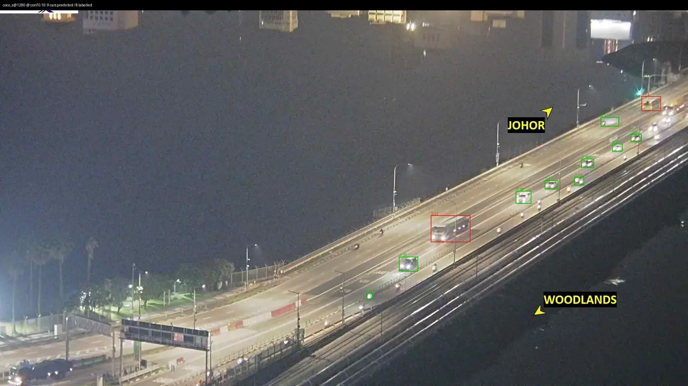</a><br>COCO YOLO-S @1280: 9 cars (+1)</td>
</tr><tr>
<td><a href="images/20250711T045532/roboflow_v6.webp">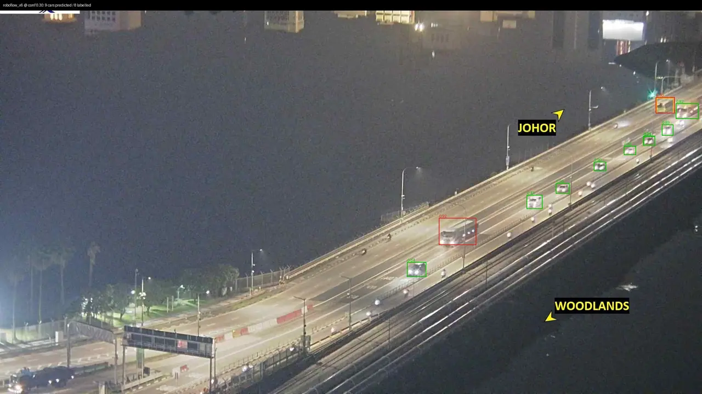</a><br>Roboflow v6: 9 cars (+1)</td>
<td><a href="images/20250711T045532/trained_s.webp"></a><br>YOLO-S trained (freeze): 8 cars (0)</td>
<td><a href="images/20250711T045532/trained_m.webp"></a><br>YOLO-M trained (freeze): 8 cars (0)</td>
</tr></table>

<a id="frame-6"></a>

### Frame 6: 14 Jul 2025 00:15 SGT

Ground truth 66 cars, 66 vehicles. Source `gs://sg-lta-traffic-cameras/camera_id=2701/month=2025-07/2701_20250714T001542.jpg`.

<table><tr>
<td><a href="images/20250714T001542/ground_truth.webp"></a><br>Ground truth</td>
<td><a href="images/20250714T001542/coco_s_640.webp">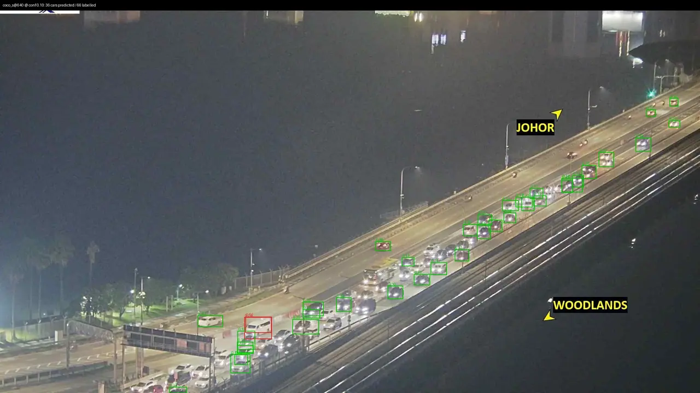</a><br>COCO YOLO-S @640: 36 cars (-30)</td>
<td><a href="images/20250714T001542/coco_s_1280.webp">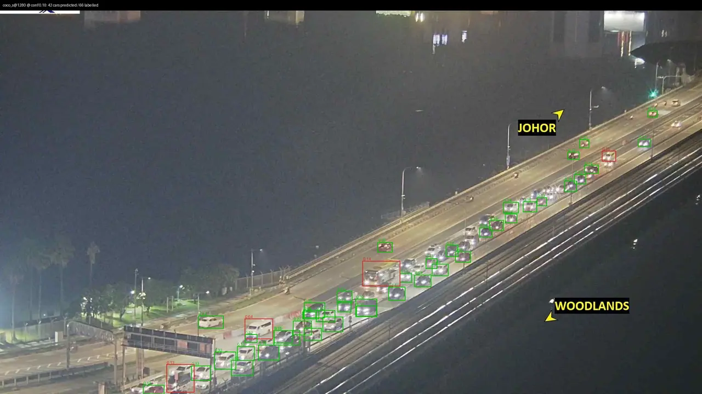</a><br>COCO YOLO-S @1280: 42 cars (-24)</td>
</tr><tr>
<td><a href="images/20250714T001542/roboflow_v6.webp">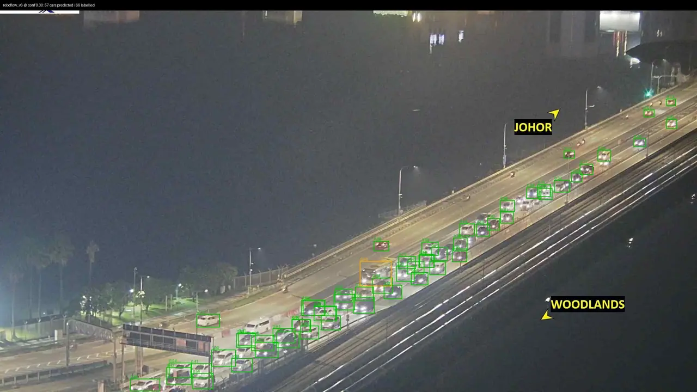</a><br>Roboflow v6: 57 cars (-9)</td>
<td><a href="images/20250714T001542/trained_s.webp">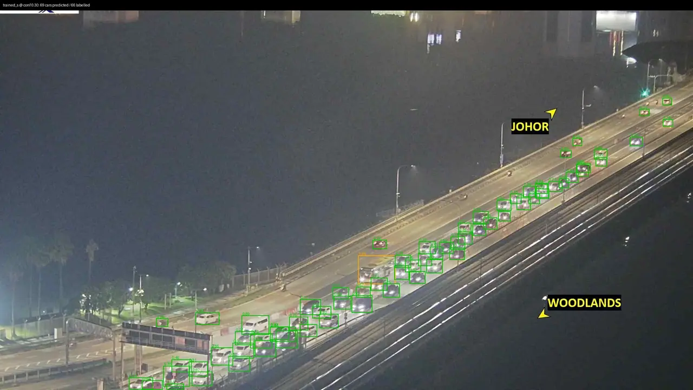</a><br>YOLO-S trained (freeze): 69 cars (+3)</td>
<td><a href="images/20250714T001542/trained_m.webp"></a><br>YOLO-M trained (freeze): 68 cars (+2)</td>
</tr></table>

<a id="frame-7"></a>

### Frame 7: 14 Jul 2025 10:55 SGT

Ground truth 56 cars, 72 vehicles. Source `gs://sg-lta-traffic-cameras/camera_id=2701/month=2025-07/2701_20250714T105553.jpg`.

<table><tr>
<td><a href="images/20250714T105553/ground_truth.webp">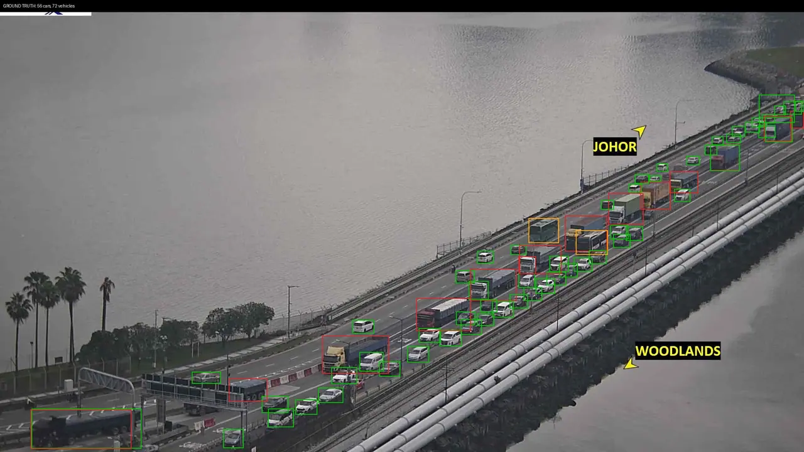</a><br>Ground truth</td>
<td><a href="images/20250714T105553/coco_s_640.webp">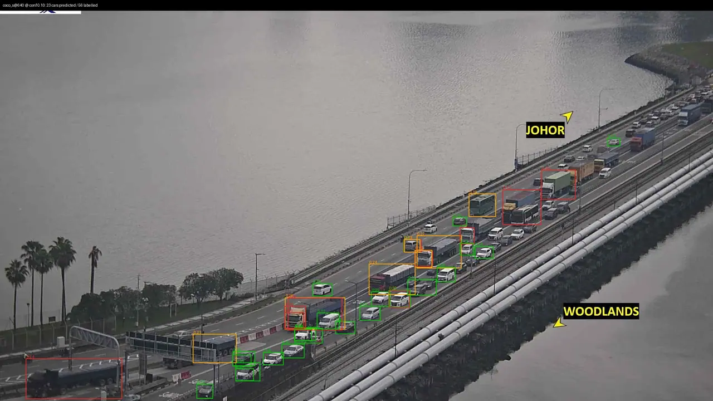</a><br>COCO YOLO-S @640: 23 cars (-33)</td>
<td><a href="images/20250714T105553/coco_s_1280.webp">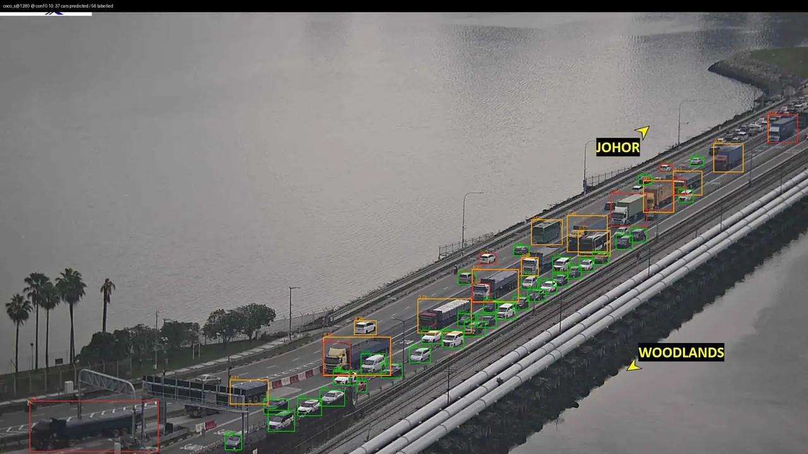</a><br>COCO YOLO-S @1280: 37 cars (-19)</td>
</tr><tr>
<td><a href="images/20250714T105553/roboflow_v6.webp">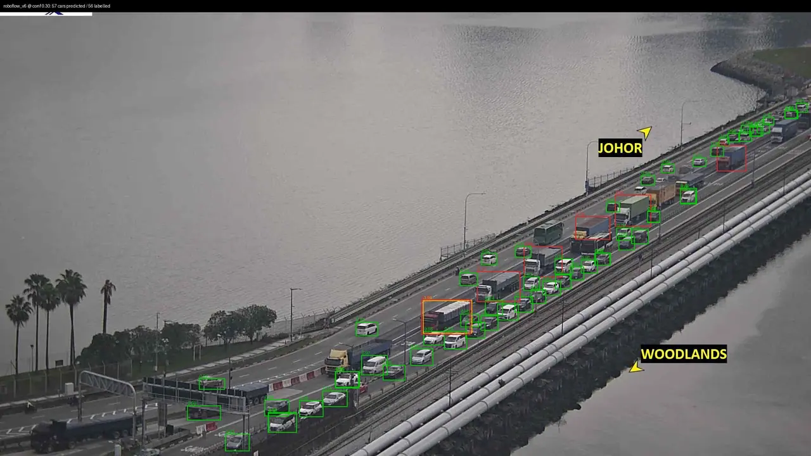</a><br>Roboflow v6: 57 cars (+1)</td>
<td><a href="images/20250714T105553/trained_s.webp"></a><br>YOLO-S trained (freeze): 56 cars (0)</td>
<td><a href="images/20250714T105553/trained_m.webp">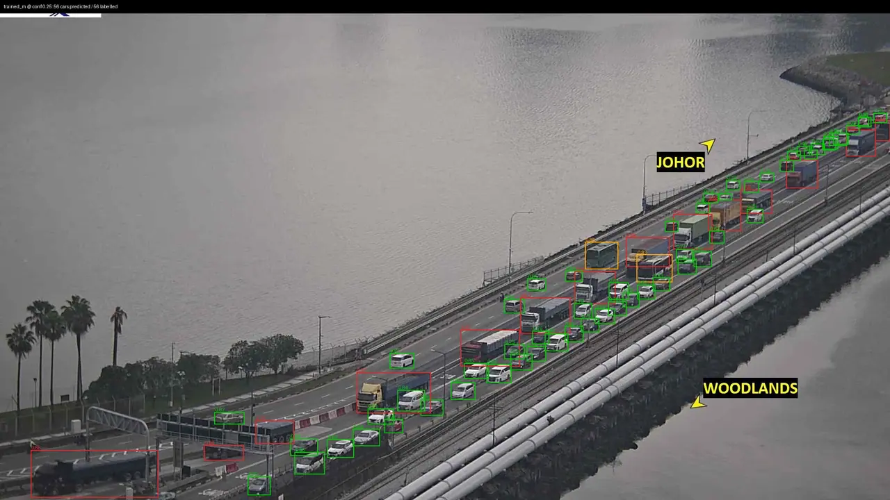</a><br>YOLO-M trained (freeze): 56 cars (0)</td>
</tr></table>

<a id="frame-8"></a>

### Frame 8: 15 Jul 2025 01:46 SGT

Ground truth 0 cars, 1 vehicles. Source `gs://sg-lta-traffic-cameras/camera_id=2701/month=2025-07/2701_20250715T014608.jpg`.

<table><tr>
<td><a href="images/20250715T014608/ground_truth.webp">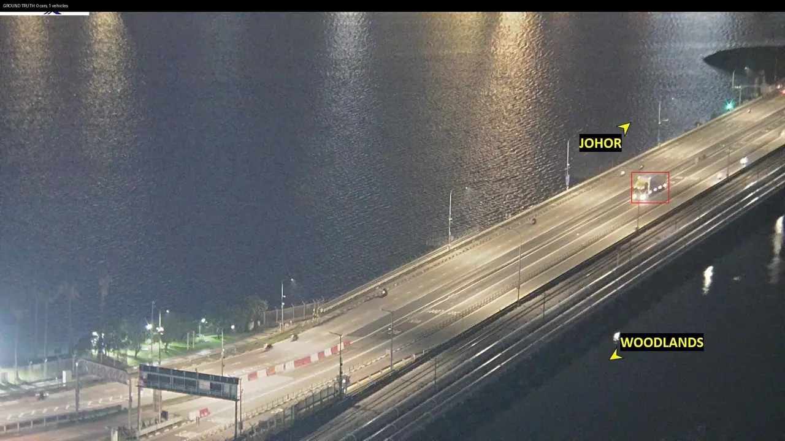</a><br>Ground truth</td>
<td><a href="images/20250715T014608/coco_s_640.webp"></a><br>COCO YOLO-S @640: 2 cars (+2)</td>
<td><a href="images/20250715T014608/coco_s_1280.webp"></a><br>COCO YOLO-S @1280: 0 cars (0)</td>
</tr><tr>
<td><a href="images/20250715T014608/roboflow_v6.webp"></a><br>Roboflow v6: 0 cars (0)</td>
<td><a href="images/20250715T014608/trained_s.webp"></a><br>YOLO-S trained (freeze): 0 cars (0)</td>
<td><a href="images/20250715T014608/trained_m.webp">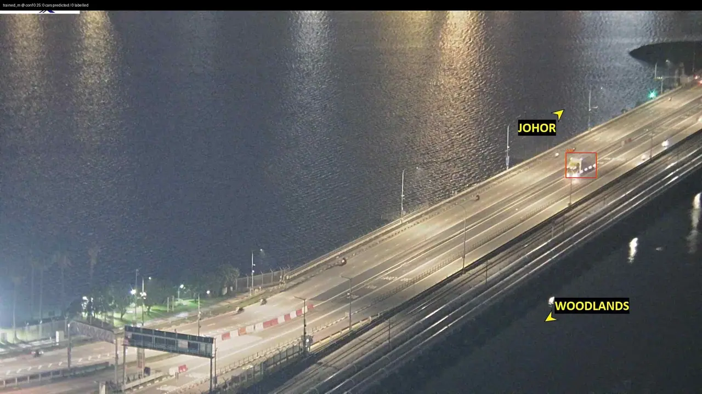</a><br>YOLO-M trained (freeze): 0 cars (0)</td>
</tr></table>

<a id="frame-9"></a>

### Frame 9: 15 Jul 2025 14:45 SGT

Ground truth 10 cars, 15 vehicles. Source `gs://sg-lta-traffic-cameras/camera_id=2701/month=2025-07/2701_20250715T144541.jpg`.

<table><tr>
<td><a href="images/20250715T144541/ground_truth.webp">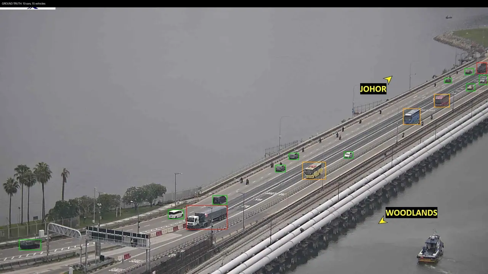</a><br>Ground truth</td>
<td><a href="images/20250715T144541/coco_s_640.webp">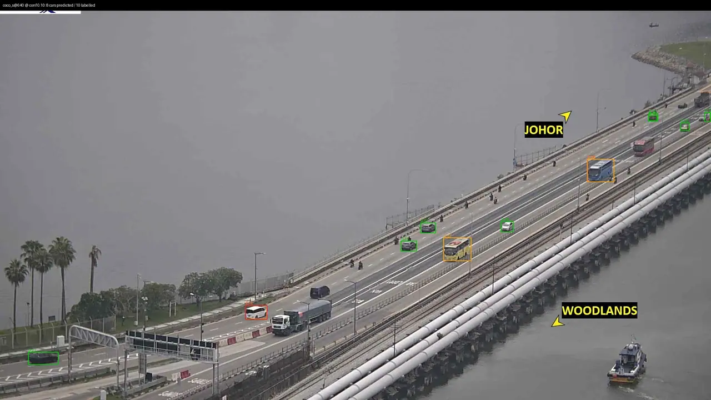</a><br>COCO YOLO-S @640: 8 cars (-2)</td>
<td><a href="images/20250715T144541/coco_s_1280.webp">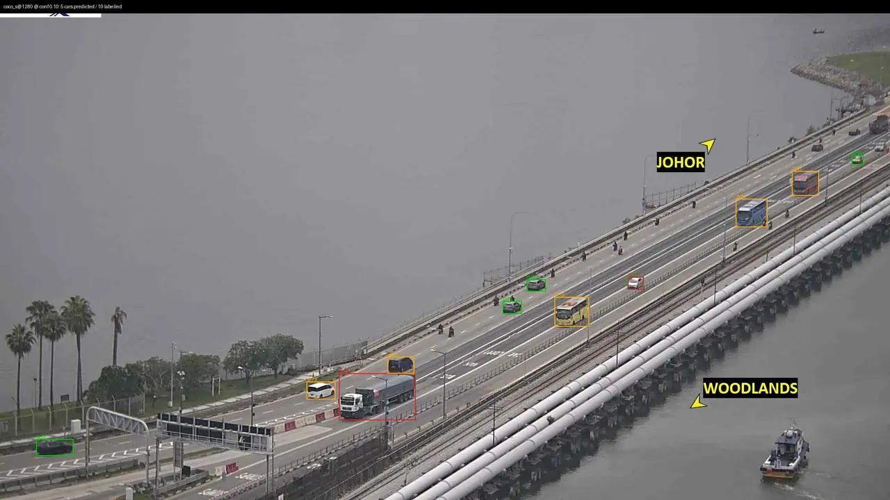</a><br>COCO YOLO-S @1280: 5 cars (-5)</td>
</tr><tr>
<td><a href="images/20250715T144541/roboflow_v6.webp">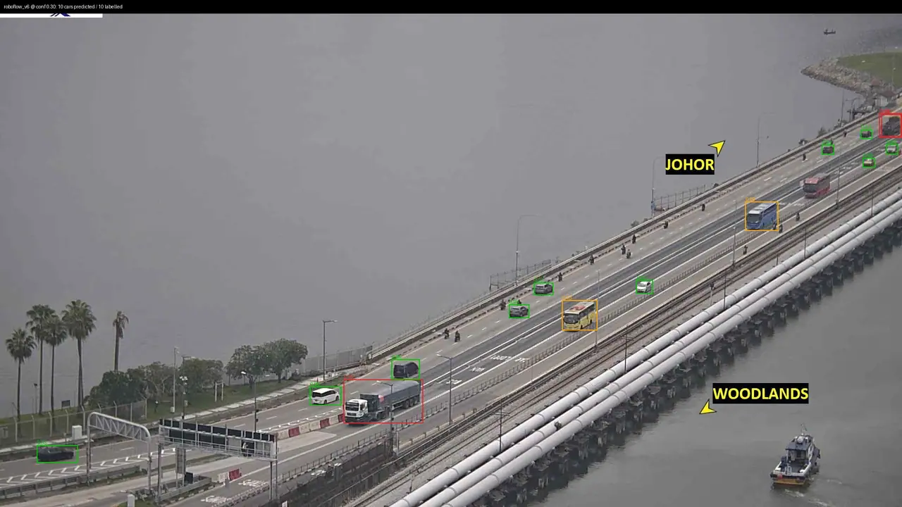</a><br>Roboflow v6: 10 cars (0)</td>
<td><a href="images/20250715T144541/trained_s.webp"></a><br>YOLO-S trained (freeze): 10 cars (0)</td>
<td><a href="images/20250715T144541/trained_m.webp"></a><br>YOLO-M trained (freeze): 10 cars (0)</td>
</tr></table>

<a id="frame-10"></a>

### Frame 10: 18 Jul 2025 18:26 SGT

Ground truth 39 cars, 45 vehicles. Source `gs://sg-lta-traffic-cameras/camera_id=2701/month=2025-07/2701_20250718T182605.jpg`.

<table><tr>
<td><a href="images/20250718T182605/ground_truth.webp">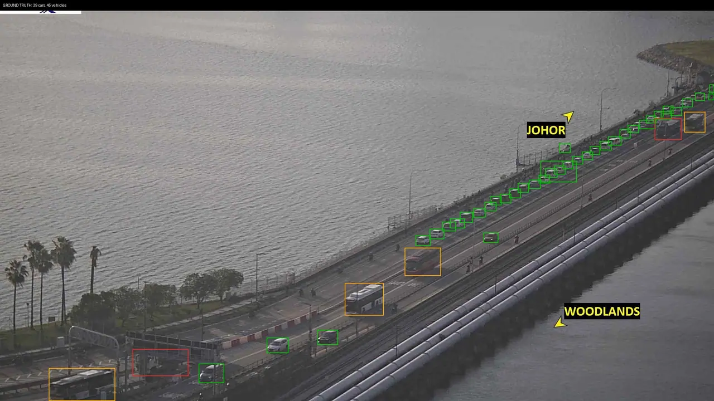</a><br>Ground truth</td>
<td><a href="images/20250718T182605/coco_s_640.webp">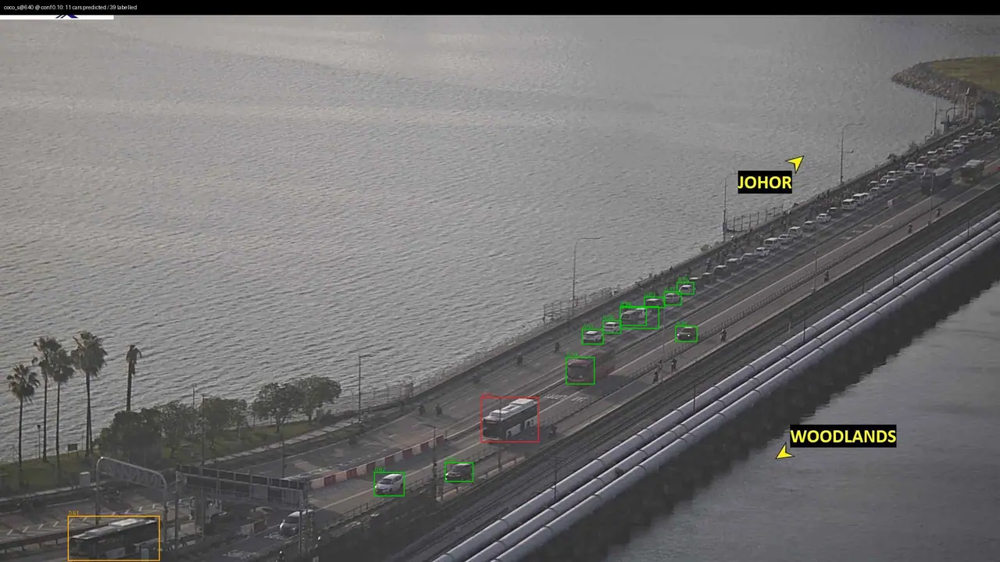</a><br>COCO YOLO-S @640: 11 cars (-28)</td>
<td><a href="images/20250718T182605/coco_s_1280.webp">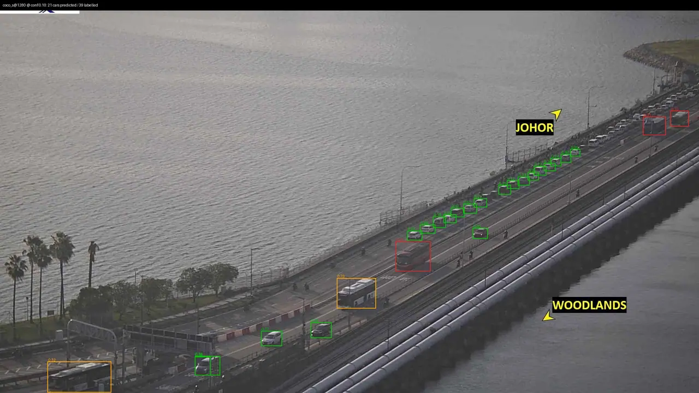</a><br>COCO YOLO-S @1280: 21 cars (-18)</td>
</tr><tr>
<td><a href="images/20250718T182605/roboflow_v6.webp">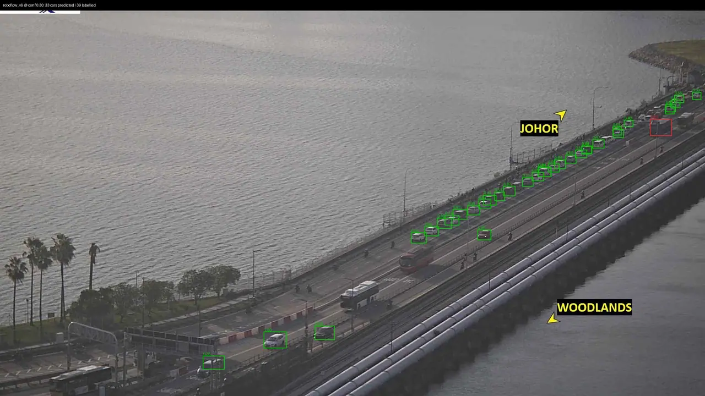</a><br>Roboflow v6: 33 cars (-6)</td>
<td><a href="images/20250718T182605/trained_s.webp">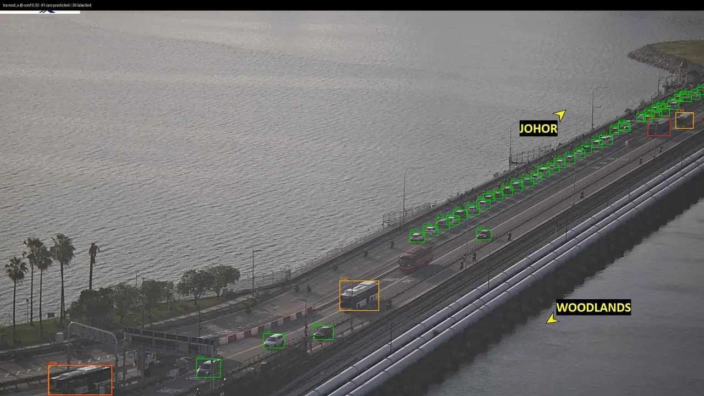</a><br>YOLO-S trained (freeze): 41 cars (+2)</td>
<td><a href="images/20250718T182605/trained_m.webp">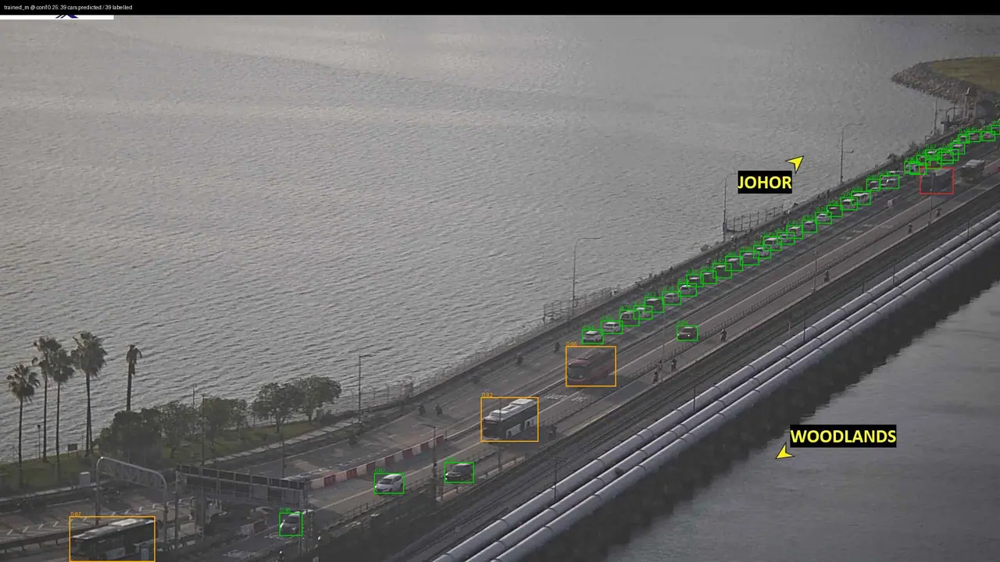</a><br>YOLO-M trained (freeze): 39 cars (0)</td>
</tr></table>

<a id="frame-11"></a>

### Frame 11: 19 Jul 2025 09:35 SGT

Ground truth 87 cars, 91 vehicles. Source `gs://sg-lta-traffic-cameras/camera_id=2701/month=2025-07/2701_20250719T093542.jpg`.

<table><tr>
<td><a href="images/20250719T093542/ground_truth.webp"></a><br>Ground truth</td>
<td><a href="images/20250719T093542/coco_s_640.webp">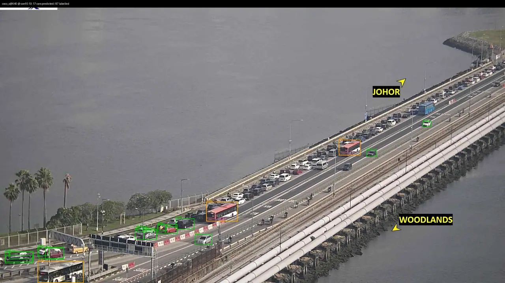</a><br>COCO YOLO-S @640: 17 cars (-70)</td>
<td><a href="images/20250719T093542/coco_s_1280.webp">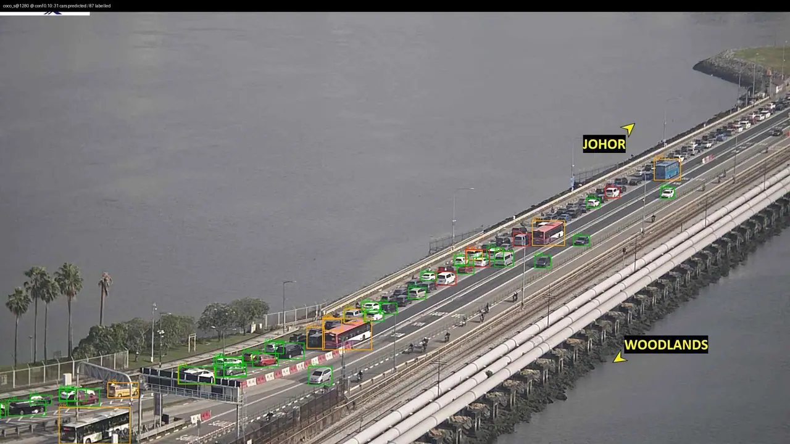</a><br>COCO YOLO-S @1280: 31 cars (-56)</td>
</tr><tr>
<td><a href="images/20250719T093542/roboflow_v6.webp"></a><br>Roboflow v6: 68 cars (-19)</td>
<td><a href="images/20250719T093542/trained_s.webp">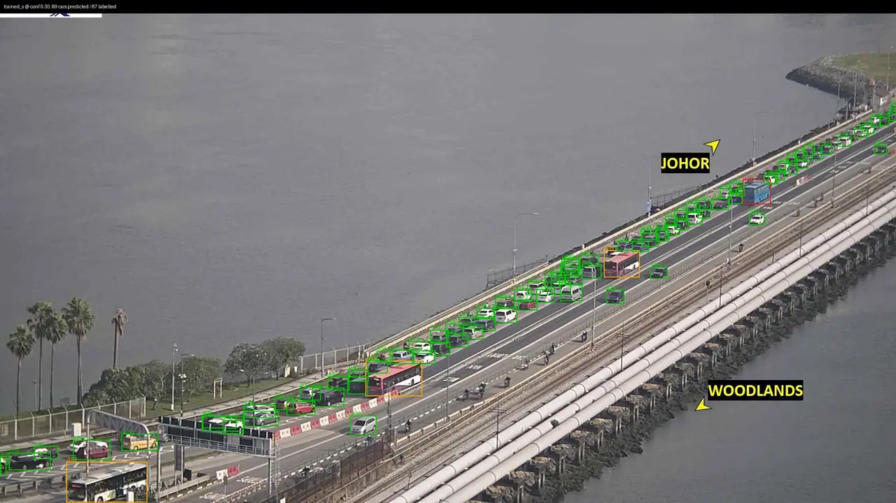</a><br>YOLO-S trained (freeze): 89 cars (+2)</td>
<td><a href="images/20250719T093542/trained_m.webp">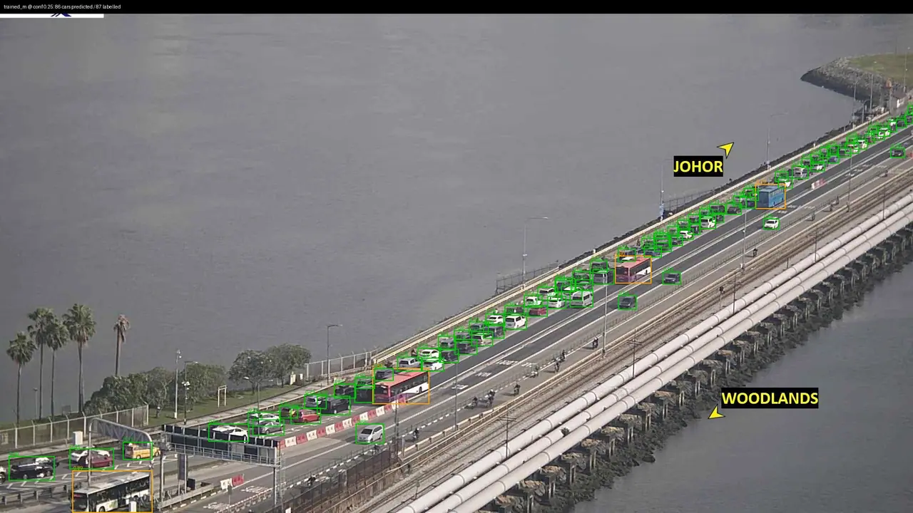</a><br>YOLO-M trained (freeze): 86 cars (-1)</td>
</tr></table>

<a id="frame-12"></a>

### Frame 12: 20 Jul 2025 02:16 SGT

Ground truth 1 cars, 3 vehicles. Source `gs://sg-lta-traffic-cameras/camera_id=2701/month=2025-07/2701_20250720T021638.jpg`.

<table><tr>
<td><a href="images/20250720T021638/ground_truth.webp">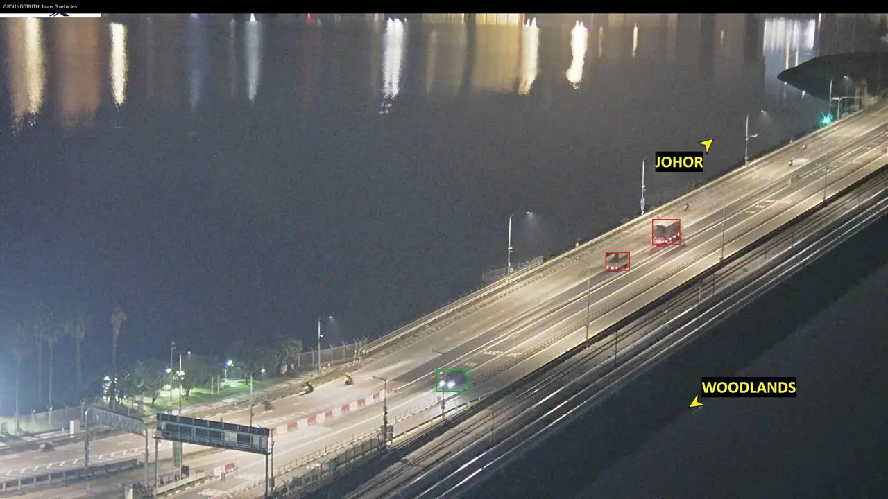</a><br>Ground truth</td>
<td><a href="images/20250720T021638/coco_s_640.webp"></a><br>COCO YOLO-S @640: 1 cars (0)</td>
<td><a href="images/20250720T021638/coco_s_1280.webp"></a><br>COCO YOLO-S @1280: 2 cars (+1)</td>
</tr><tr>
<td><a href="images/20250720T021638/roboflow_v6.webp">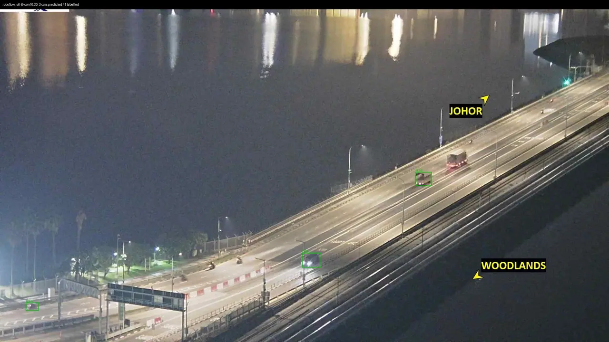</a><br>Roboflow v6: 3 cars (+2)</td>
<td><a href="images/20250720T021638/trained_s.webp"></a><br>YOLO-S trained (freeze): 1 cars (0)</td>
<td><a href="images/20250720T021638/trained_m.webp"></a><br>YOLO-M trained (freeze): 0 cars (-1)</td>
</tr></table>

<a id="frame-13"></a>

### Frame 13: 22 Jul 2025 07:46 SGT

Ground truth 24 cars, 51 vehicles. Source `gs://sg-lta-traffic-cameras/camera_id=2701/month=2025-07/2701_20250722T074652.jpg`.

<table><tr>
<td><a href="images/20250722T074652/ground_truth.webp">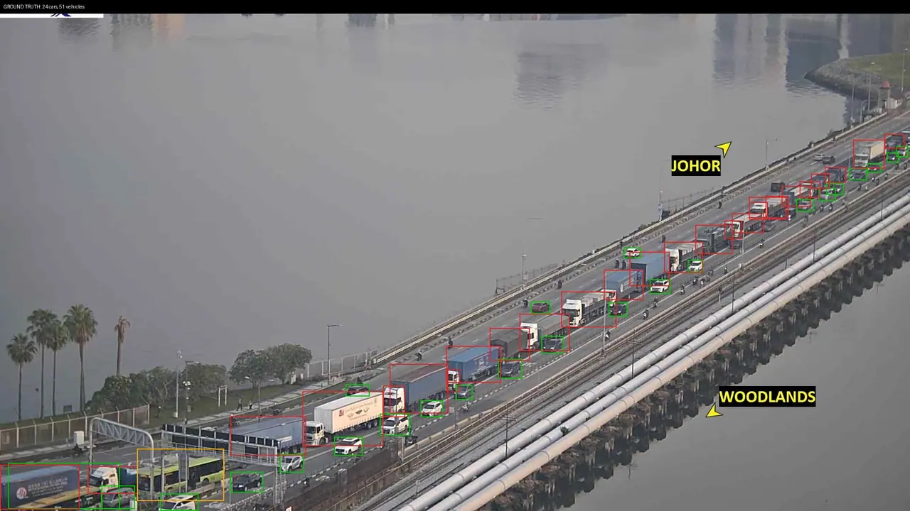</a><br>Ground truth</td>
<td><a href="images/20250722T074652/coco_s_640.webp">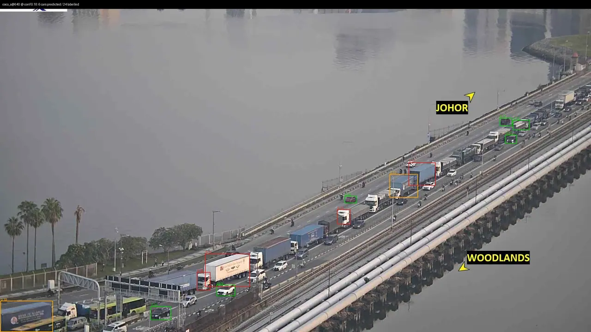</a><br>COCO YOLO-S @640: 6 cars (-18)</td>
<td><a href="images/20250722T074652/coco_s_1280.webp">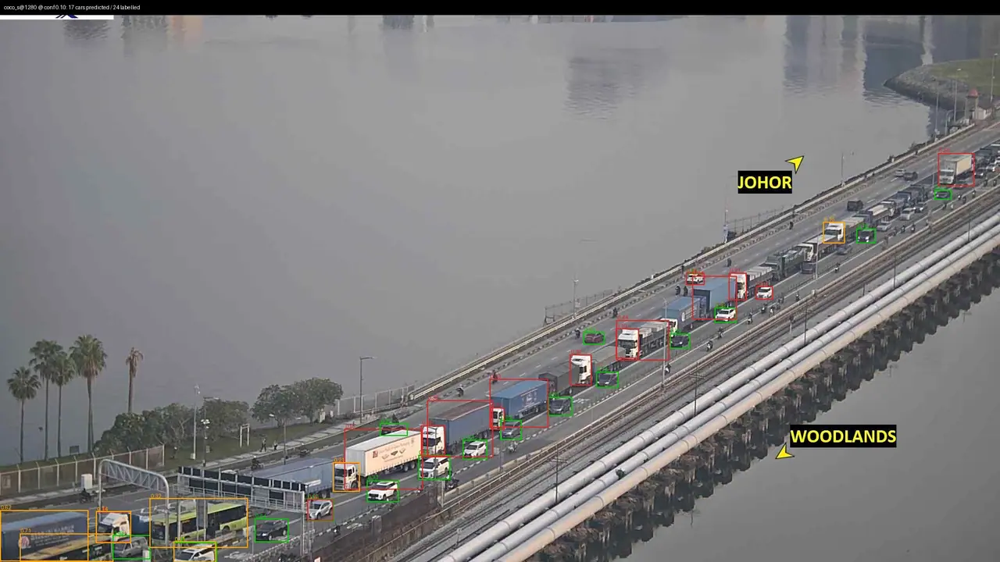</a><br>COCO YOLO-S @1280: 17 cars (-7)</td>
</tr><tr>
<td><a href="images/20250722T074652/roboflow_v6.webp">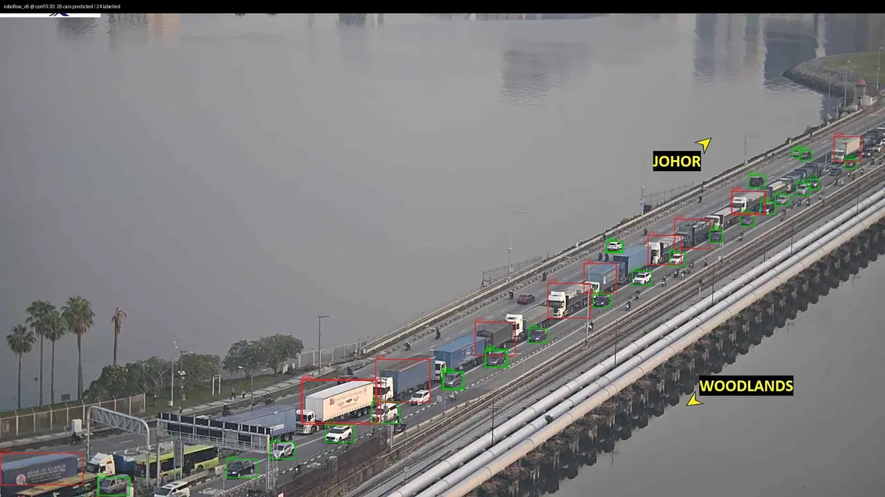</a><br>Roboflow v6: 26 cars (+2)</td>
<td><a href="images/20250722T074652/trained_s.webp">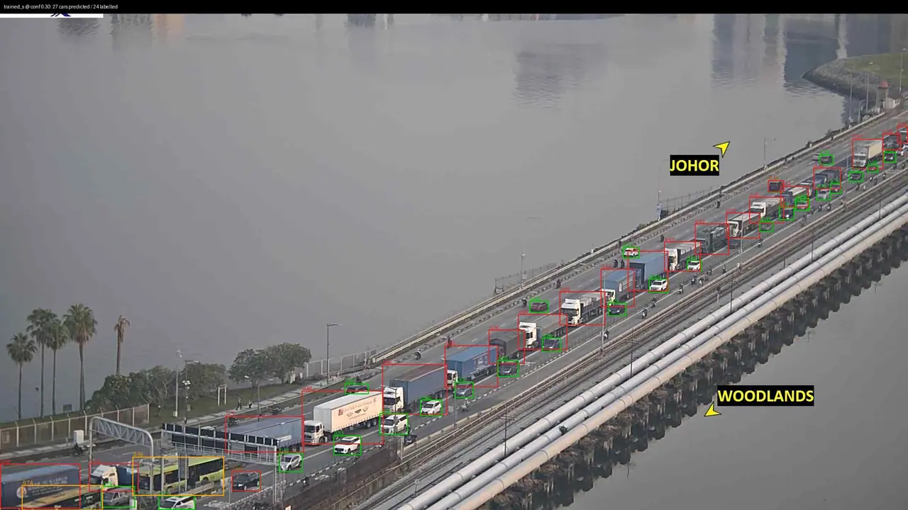</a><br>YOLO-S trained (freeze): 27 cars (+3)</td>
<td><a href="images/20250722T074652/trained_m.webp"></a><br>YOLO-M trained (freeze): 28 cars (+4)</td>
</tr></table>

<a id="frame-14"></a>

### Frame 14: 22 Jul 2025 19:57 SGT

Ground truth 15 cars, 26 vehicles. Source `gs://sg-lta-traffic-cameras/camera_id=2701/month=2025-07/2701_20250722T195703.jpg`.

<table><tr>
<td><a href="images/20250722T195703/ground_truth.webp"></a><br>Ground truth</td>
<td><a href="images/20250722T195703/coco_s_640.webp"></a><br>COCO YOLO-S @640: 10 cars (-5)</td>
<td><a href="images/20250722T195703/coco_s_1280.webp"></a><br>COCO YOLO-S @1280: 13 cars (-2)</td>
</tr><tr>
<td><a href="images/20250722T195703/roboflow_v6.webp"></a><br>Roboflow v6: 14 cars (-1)</td>
<td><a href="images/20250722T195703/trained_s.webp"></a><br>YOLO-S trained (freeze): 12 cars (-3)</td>
<td><a href="images/20250722T195703/trained_m.webp"></a><br>YOLO-M trained (freeze): 16 cars (+1)</td>
</tr></table>

<a id="frame-15"></a>

### Frame 15: 01 Sep 2025 19:06 SGT

Ground truth 25 cars, 29 vehicles. Source `gs://sg-lta-traffic-cameras/camera_id=2701/month=2025-09/2701_20250901T190618.jpg`.

<table><tr>
<td><a href="images/20250901T190618/ground_truth.webp"></a><br>Ground truth</td>
<td><a href="images/20250901T190618/coco_s_640.webp"></a><br>COCO YOLO-S @640: 31 cars (+6)</td>
<td><a href="images/20250901T190618/coco_s_1280.webp"></a><br>COCO YOLO-S @1280: 29 cars (+4)</td>
</tr><tr>
<td><a href="images/20250901T190618/roboflow_v6.webp"></a><br>Roboflow v6: 28 cars (+3)</td>
<td><a href="images/20250901T190618/trained_s.webp"></a><br>YOLO-S trained (freeze): 28 cars (+3)</td>
<td><a href="images/20250901T190618/trained_m.webp"></a><br>YOLO-M trained (freeze): 28 cars (+3)</td>
</tr></table>
