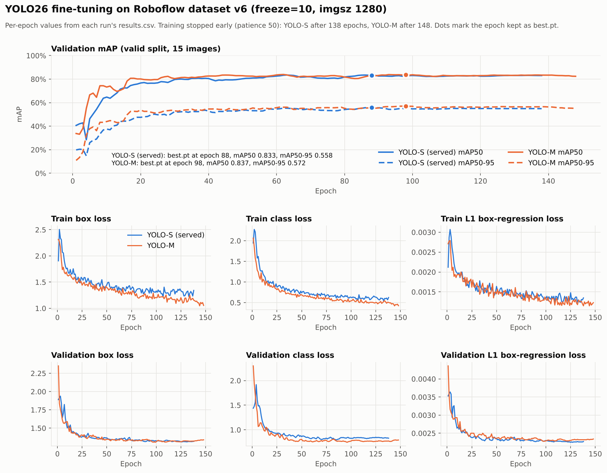
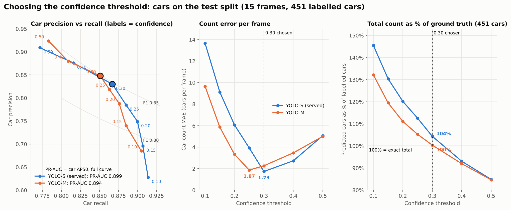

# Layer A training and comparison runs

Training runs, Ultralytics evaluations and the five-detector comparison behind the
[test report](../README.md). Copied on 17 Oct 2026 from the team Drive folder
[`swiftborder_runs`](https://drive.google.com/drive/folders/1G_jBEMYGorHnfOEvcHse4pXJ2yRdv7HG)
and regrouped by model. All of it was produced by
[`vehicle_detection_comparison.ipynb`](../notebooks/vehicle_detection_comparison.ipynb)
on Roboflow dataset v6 (train 60 / valid 15 / test 15 images).

Nothing here is used by the service. The served model is the ONNX export in
[`services/camdetect/models/`](../../../services/camdetect/models/); nothing under `eval/` is in the Docker image.

```
runs/
├── yolo26s/                     YOLO26s fine-tuned (freeze=10): the served model, model=local
│   ├── best (yolo26s).pt        the best.pt checkpoint (20 MB)
│   ├── training/                was v6_yolo26s_boxfix/ (no weights/ folder: best.pt is the file above)
│   │   ├── args.yaml            training settings
│   │   ├── results.csv/.png     loss and metrics per epoch
│   │   ├── labels.jpg           label statistics of the training set
│   │   ├── train_batch*.jpg     augmented training batches
│   │   └── Box*_curve.png, confusion_matrix*.png, val_batch*.jpg
│   │                            end-of-training check of best.pt on the valid split
│   └── eval_test/               was val_yolo26s_test_boxfix/: Ultralytics val on the test split
├── yolo26m/                     YOLO26m fine-tuned the same way; compared, not served
│   ├── best (yolo26m).pt        the best.pt checkpoint (44 MB)
│   ├── training/                was v6_yolo26m_boxfix/ (same layout)
│   └── eval_test/               was val_yolo26m_test_boxfix/
└── comparison_5_detectors/      summary CSVs only in git (annotated frames: [`../images/`](../images/) WebPs; full JPEG tree on Drive)
    ├── full_comparison_summary.csv   AP50 per class, recall/precision sweep, count error (valid and test)
    └── test_counts.csv               car and vehicle counts per detector and frame
training_curves.csv / .png       per-epoch metrics and losses of both runs
plot_training_curves.py          builds the two files above from each results.csv
threshold_sweep.csv / .png       car recall, precision and count error vs confidence
plot_threshold_sweep.py          builds them from the notebook output
```

Annotated test frames for the report live under [`../images/`](../images/) (WebP). The CSVs and the
notebook use the Roboflow export names (`..._jpg.rf.<hash>.jpg`); the frames manifest maps one to the other.

## Training

| Run | Base | Image size | Batch | Epochs run (patience 50) | Best epoch | valid mAP50 | valid mAP50-95 | `best.pt` |
| --- | --- | ---: | ---: | ---: | ---: | ---: | ---: | --- |
| `yolo26s/training` | `yolo26s.pt` | 1280 | 8 | 138 of 150 | 88 | 0.833 | 0.558 | 20,389,957 bytes, sha256 `de7d105b...abf0e` |
| `yolo26m/training` | `yolo26m.pt` | 1280 | 4 | 148 of 150 | 98 | 0.837 | 0.572 | 44,104,281 bytes, sha256 `b01464f5...1fa02` |

Both: AdamW, `lr0=0.001`, cosine LR, `freeze=10`, seed 0, labels converted from polygons to boxes
first (the `boxfix` in the old names). Best epoch and its scores are read from `results.csv`. The
`valid` split also picked the checkpoint, so these two columns are not held-out scores. The YOLO-S
`best.pt` hash matches the checkpoint recorded for the served ONNX file in the
[camdetect README](../../../services/camdetect/README.md#in-container-model-modellocal). The two `best.pt` files are the files named `best (<model>).pt` next to each `training/` folder. `last.pt` (the final epoch) was left
on Drive.

Per-epoch curves for both runs, in one table and one chart:
[`training_curves.csv`](training_curves.csv) (one row per model and epoch; `best_epoch` = 1 marks the
`best.pt` epoch) and [`training_curves.png`](training_curves.png) (validation mAP50 and mAP50-95 on
top; train and validation box, class and L1 losses below). YOLO26 has no objectness loss, so there is
no "object loss" panel. Rebuild both with `python eval/test-reports/runs/plot_training_curves.py`.



Car recall, precision and count error at confidence 0.10-0.50 for both models, parsed from the
notebook output: [`threshold_sweep.csv`](threshold_sweep.csv) (valid and test splits) and
[`threshold_sweep.png`](threshold_sweep.png) (test split: precision vs recall with each model's car
PR-AUC, count MAE, and the total count as a % of the 451 labelled cars). Rebuild with
`python eval/test-reports/runs/plot_threshold_sweep.py`. The points are a 7-threshold sweep; the
PR-AUC is car AP50 from the notebook's full-comparison cell (0.899 YOLO-S, 0.894 YOLO-M). The
per-box predictions behind a full precision-recall curve are not in the repo (Ultralytics' own
full curves are `BoxPR_curve.png` in each `eval_test/` folder). Count error is lowest at 0.30 (YOLO-S)
and 0.25 (YOLO-M) on test, and at 0.40 for both on valid. Picking the threshold on test is
optimistic; the served setting is conf 0.20 with overlap 0.6.



## Ultralytics evaluation on the test split

`eval_test/` is `model.val()` on the 15 test frames (546 labelled boxes), the frames in the test
report. Numbers from the notebook output; the folders hold only the plots.

| Model | Precision | Recall | mAP50 | mAP50-95 |
| --- | ---: | ---: | ---: | ---: |
| YOLO-S (`yolo26s/eval_test`) | 0.813 | 0.791 | 0.836 | 0.562 |
| YOLO-M (`yolo26m/eval_test`) | 0.883 | 0.770 | 0.872 | 0.583 |

The notebook's own comparison scorer gives mAP50 0.827 (S) and 0.862 (M) on the same frames
([test report](../README.md#box-metrics-test-split)); the two scorers match boxes
differently.

## Left out

- `val_yolo26s_valid_boxfix/`, `val_yolo26m_valid_boxfix/` on Drive: `model.val()` on the valid
  split, which repeats the end-of-training check already in each `training/` folder.
- `weights/last.pt` for both runs (20 MB and 44 MB): the final epoch, not used anywhere.
